# Robot Fleet Console

A production-grade web console to supervise, teleoperate and audit a fleet of warehouse robots, with live video from
a real robot. Serverless on AWS, built end to end with TypeScript, React, Python and Terraform: robot identity,
real-time telemetry, safe remote control, alerts and KPIs, infrastructure as code and a DevSecOps pipeline.

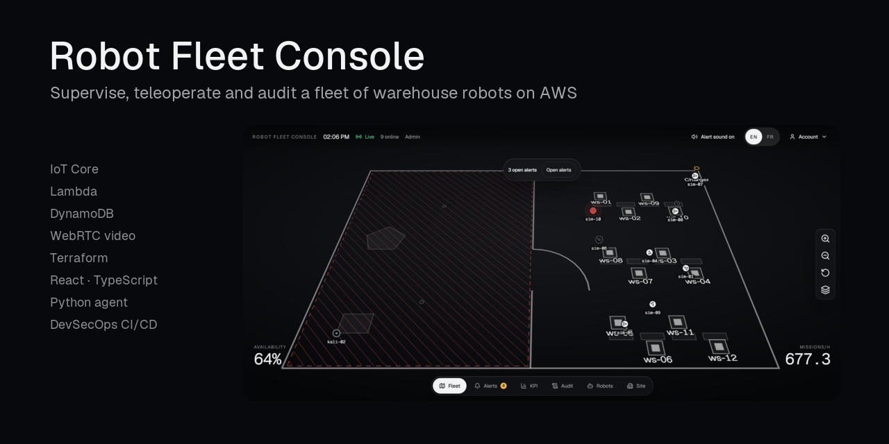

**Highlights**

- **Safe teleoperation.** One operator per robot through a lock held in the cloud, a deadman on the robot that pauses
  it after 1 s without a heartbeat even when the network is down, and an e-stop that always wins and survives a
  reboot. The rules are one state table shared by the cloud and the robot, with a parity test between TypeScript and
  Python ([ADR 0028](docs/adr/0028-robot-safety-state-machine-lock-deadman-estop-latch.md)).
- **Device identity.** One X.509 certificate per robot over MQTT 5 with mutual TLS, and one IoT policy that keeps
  each robot on its own topics, checked live with nine isolation probes
  ([ADR 0030](docs/adr/0030-iot-policy-bound-to-thing-name-and-thing-attributes.md)).
- **Measured.** Command round trip of 295 ms at the median and 470 ms at the 95th percentile, and a WebRTC video
  transport latency of 45 ms at the median ([`docs/PERFORMANCE.md`](docs/PERFORMANCE.md)).
- **No long-lived AWS key.** SSO for people, OIDC for CI, certificates and the IoT credentials provider for robots.
  Every change goes through a blocking security gate (Gitleaks, Semgrep, Trivy, Checkov, dependency audits, zizmor),
  and OWASP ZAP finds no High or Medium alert on the console.
- **Infrastructure as code.** Everything is Terraform, about 8 minutes from a merge to production, with 37 CloudWatch
  alarms and dead-letter queues on every asynchronous path.
- **Decisions and incidents on record.** 69 architecture decision records in [`docs/adr/`](docs/adr/), a STRIDE threat
  model with 71 threats, and an engineering journal of every real problem and its fix
  ([`docs/JOURNAL.md`](docs/JOURNAL.md)).
- **Cost-aware.** About 3 USD per robot and per month for 20 robots running 12 h a day (estimate), under 5 USD a month
  at rest ([`docs/COSTS.md`](docs/COSTS.md)).

The prefix `mfc` in resource and package names stands for **multi-robot fleet console**.

## What it does

Every item below is implemented in the repository. The items that are not finished are listed in
[Limits and what is not built](#limits-and-what-is-not-built).

- **Fleet view and alerts.** The active site plan is drawn as a tilted map, with one marker per robot. Each robot state
  has its own shape, icon and text. Alerts (`ESTOP` critical, `BLOCKED` and `OFFLINE` major, `LOW_BATTERY` minor) open
  from the robot's events. An Admin or an Operator acknowledges and resolves them. A critical or major alert is
  announced to assistive technology and plays a sound, once the user has enabled it.
- **Site configuration.** An Admin imports a DXF drawing. It is parsed in a Web Worker in the browser and is never
  uploaded. The layers are mapped to walls, obstacles or ignored. The charging base, the workstations and the no-go
  zones are placed on the plan. The result is saved as a new GeoJSON map version, validated, then activated.
- **Robot page.** Live WebRTC video from the robot's camera (Kinesis Video Streams), the state, the readouts, a state
  timeline for the session, the command panel with the ACK latency of each command, and the lock holder.
- **Control lock and safety.** One Operator or Admin holds the control of a robot at a time. The lock lives in the
  cloud and expires 30 s after the holder's last activity. The console sends a heartbeat every 250 ms while it holds
  the lock and the tab is visible. The robot pauses when no heartbeat reaches its deadman for 1 s. The e-stop needs no
  lock and no confirmation. Releasing the e-stop asks for a confirmation. `DRIVE` is refused.
- **Audit.** Every command, lock change, demo change and refusal writes one record. The records are read through
  `GET /sites/{siteId}/audit`, and shown in the audit sheet of the console (every role can read it), which filters the records by robot and by result. An Admin switches the
  demo mode on and off from the user menu; a banner shows while it is on.
- **Simulated fleet.** `make sim` runs 1 to 20 simulated robots. They drive on the active map of the site and run
  missions. A robot that would meet another one waits for it to pass, so the simulated robots do not overlap on the map
  (ADR 0079). Each run stops by itself after 2 h.
- **Local demo control server.** A page on `127.0.0.1` starts and stops the simulated fleet, prints the console link,
  lists the robots and the operator accounts, and creates or resets Operator and Viewer accounts (see
  [Run the demo](#run-the-demo)).
- **Security gates.** Gitleaks, Semgrep, Trivy, the pnpm and pip audits, zizmor, Checkov, TFLint and the Terraform
  tests run in CI. An OWASP ZAP baseline runs against the deployed console.
- **Deployed end-to-end test.** After each deploy of `main`, a Playwright scenario runs against the deployed console.
  It creates an Operator and a simulated robot for the run, and deletes both afterwards.

Roles are Admin, Operator and Viewer. Every role uses TOTP MFA. The interface is available in English and French.

## Screenshots

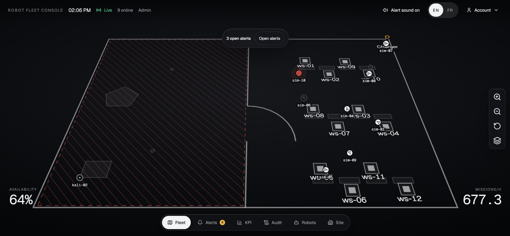

_Fleet view: the active site plan with simulated robots and the real robot agent. Each state has its own shape and text._

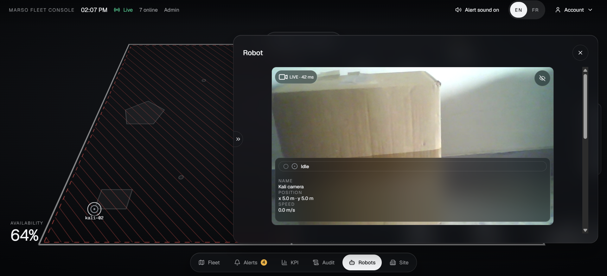

_Robot page: live WebRTC video with its latency, state, and the control lock._

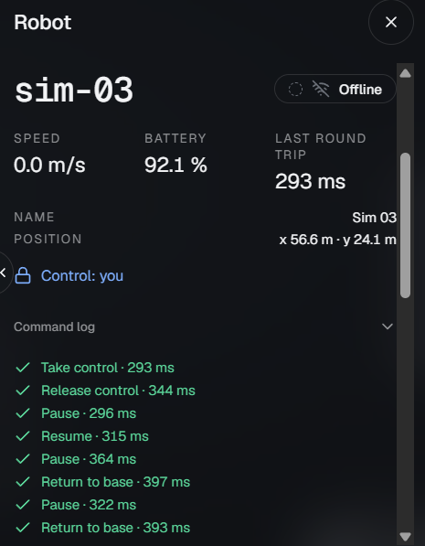

_Command log: each command shows its round-trip time up to the robot's acknowledgement. See [`docs/PERFORMANCE.md`](docs/PERFORMANCE.md)._

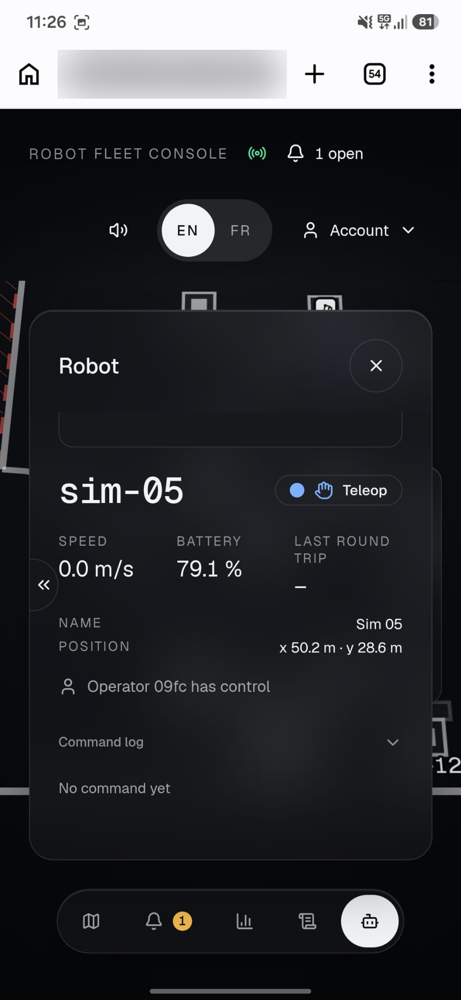

_A second operator sees who holds the control of a robot and cannot command it._

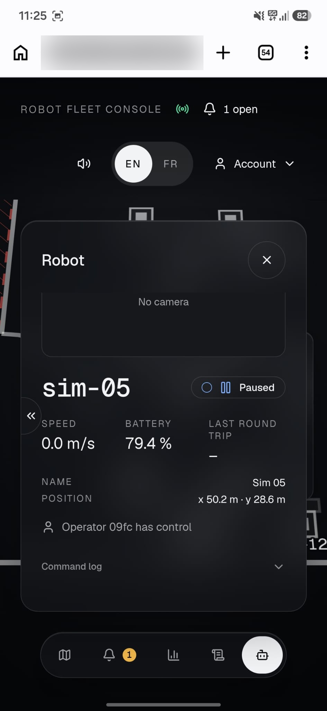

_Deadman: the robot pauses when its operator stops sending heartbeats, for example after closing the tab._

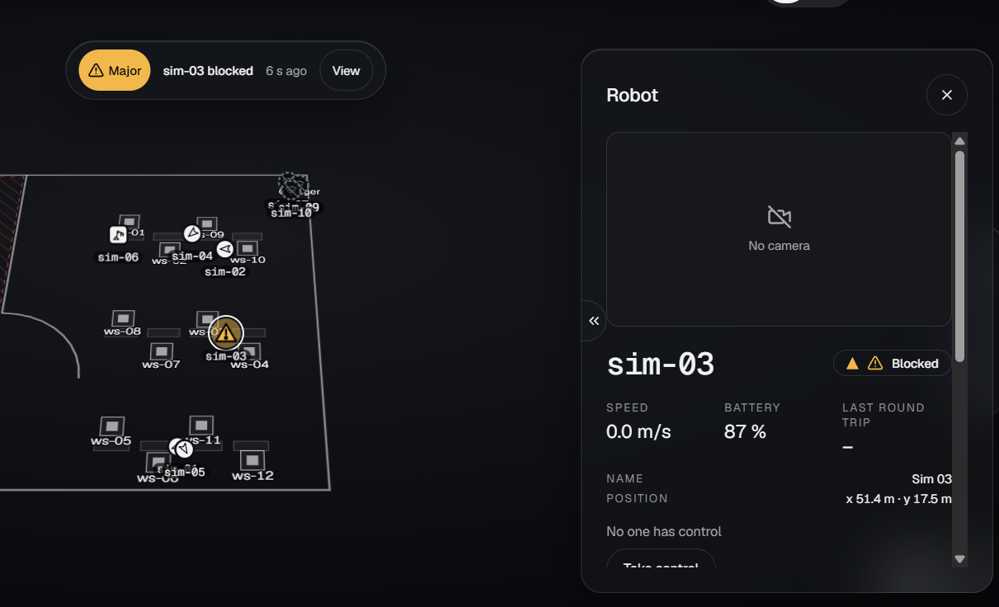

_An open Major alert: severity as text and icon, never colour alone._

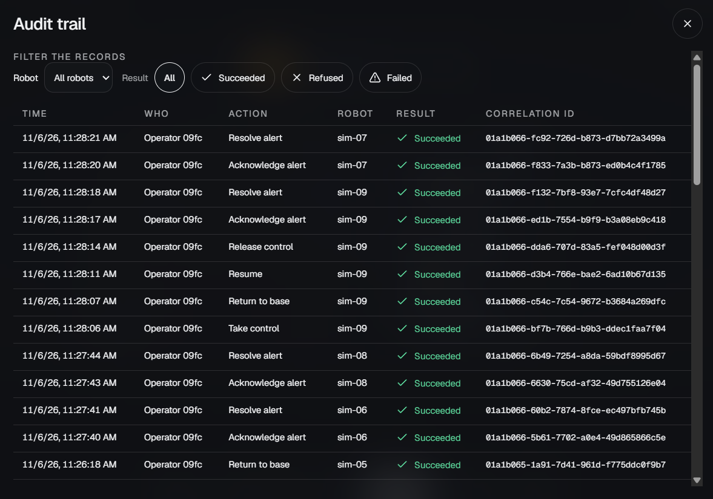

_Audit trail: who did what, on which robot, with the result and the correlation id. It can be filtered by robot and result._

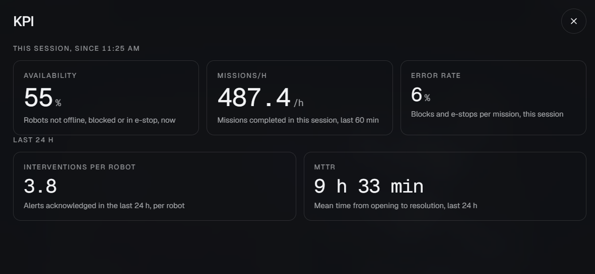

_KPI sheet for the session and the last 24 hours. The fleet is simulated, so the values show the computation, not a real performance._

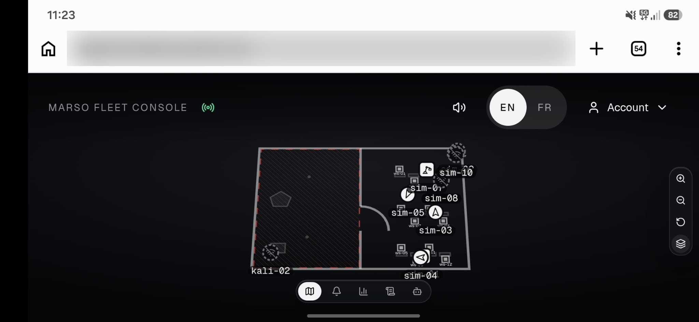

_The console on a phone over a mobile network._

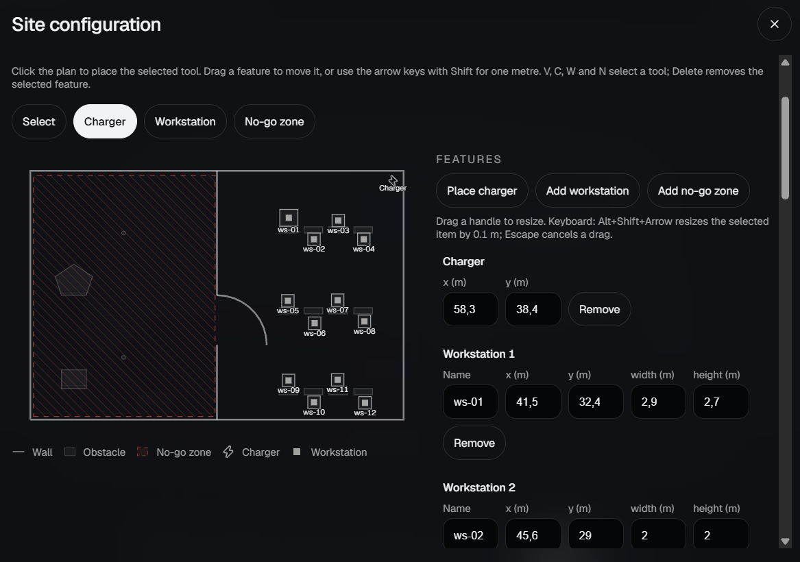

_The site map made from a DXF file: charging base, workstations and no-go zone._

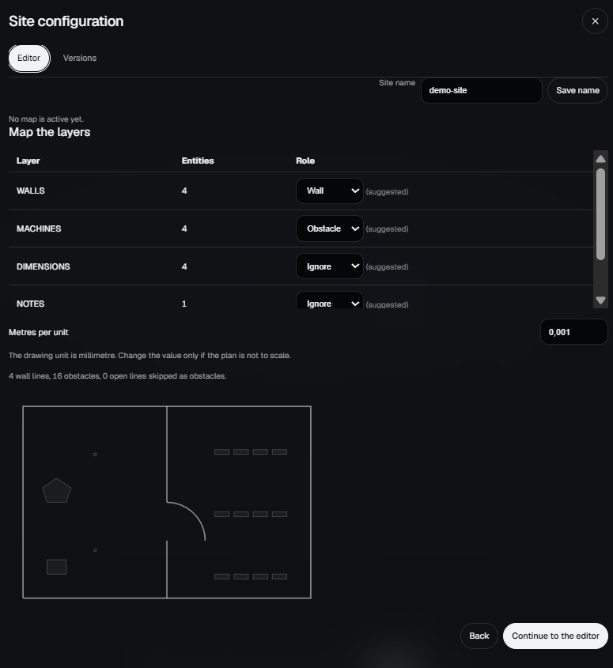

_The DXF file is read in the browser, in a Web Worker, and never leaves it._

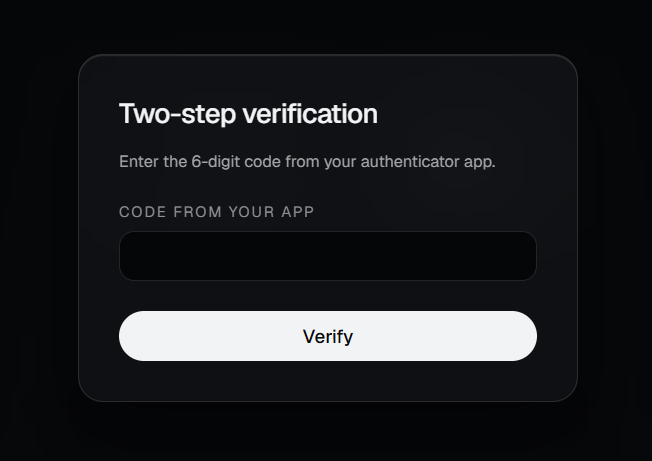

_Every role signs in with a second factor._

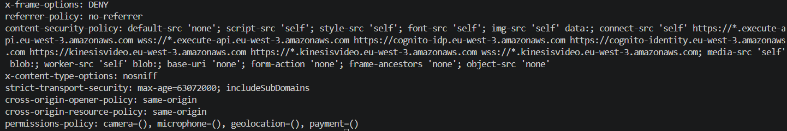

_The console is served with a strict Content Security Policy and the usual security headers._

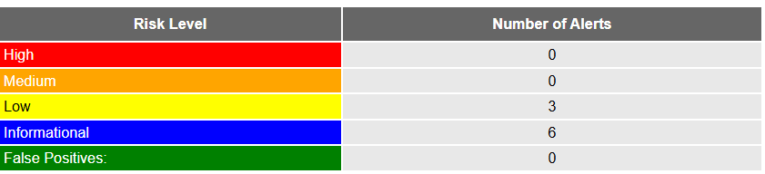

_OWASP ZAP baseline on the deployed console: no High and no Medium alert._

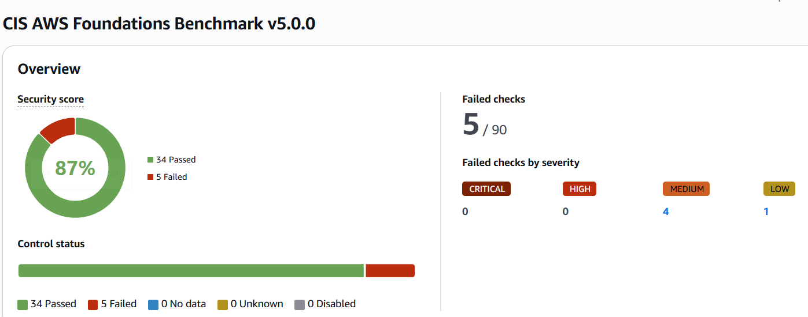

_Security Hub, CIS AWS Foundations Benchmark v5.0.0: score 87 %, no High or Critical failure. The five failed controls are cost trade-offs accepted in the threat model (R105 to R109)._

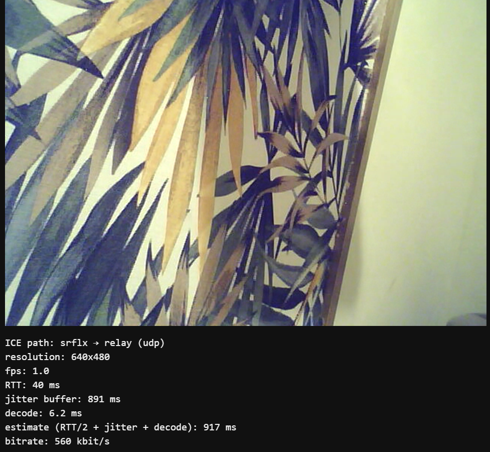

_First live video from the webcam of the robot agent._

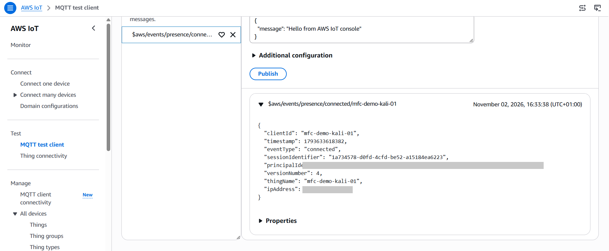

_The robot as an IoT thing, connected with its own certificate._

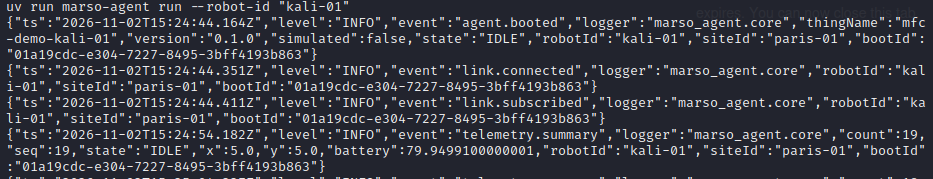

_The robot agent writes JSON lines: telemetry, events and acknowledgements._

More screenshots are in [`docs/screenshots/`](docs/screenshots/).

## Architecture

The console is a static site. It talks to the cloud through an HTTP API (REST, with a JWT) and a WebSocket API (the live
stream and the heartbeat). The robots talk to AWS IoT Core over MQTT with mTLS, one X.509 certificate per robot. The
video goes directly between the robot and the browser, through Kinesis Video Streams WebRTC.

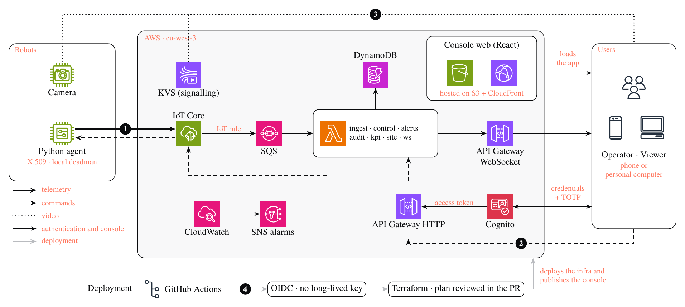

_Line styles carry the flow: solid for telemetry, dashed for commands and acknowledgements, dotted for the video, thin for
authentication and the console, grey for the deployment. Markers: **1** telemetry at 0.5 to 2 Hz in batches of 100
messages or 1 s, **2** command and acknowledgement, **3** peer-to-peer WebRTC video (Kinesis Video Streams only carries the
signalling), **4** about 8 minutes from a merge to production. The source is
[`docs/report/overleaf/figures/architecture-en.tex`](docs/report/overleaf/figures/architecture-en.tex)._

The stack and the pinned versions, as the manifests state them:

- Console: React 19.3, TypeScript 6.0, Vite 8.3, React Router 8.5, TanStack Query 5, Zustand 5, CSS modules over design
  tokens, zod 4.6, Vitest 5.0 and Playwright 1.64.
- API: Lambda on Node.js 24 (`nodejs24.x`, ARM64), TypeScript, esbuild 0.28, AWS Powertools for Lambda (logger 2.36),
  zod 4.6, API Gateway HTTP and WebSocket, DynamoDB, SQS, S3 and CloudFront.
- Devices: AWS IoT Core (MQTT 5, X.509), Kinesis Video Streams WebRTC, Python 3.12, pydantic 2.14, the AWS IoT Device SDK
  for Python 1.31 (`awsiotsdk`), pytest 9.1, ruff 0.17 and mypy 2.4 in strict mode.
- Identity: Amazon Cognito, with a user pool for the console and an identity pool for the video viewer.
- Infrastructure: Terraform (`~1.17` in the workflows), GitHub Actions with OIDC, region `eu-west-3`.

The Lambda functions, one role each:

| Function                                    | Trigger                                               | Does                                                                               |
| ------------------------------------------- | ----------------------------------------------------- | ---------------------------------------------------------------------------------- |
| `ingest-telemetry`                          | SQS, batches of up to 100 messages or a 1 s window    | Updates the live state, sends one `fleet.delta` per site to the subscribed sockets |
| `ingest-events`                             | IoT rules for events, acknowledgements and presence   | Updates the live state, writes the history and the alerts, relays changes          |
| `ws-connect`, `ws-message`, `ws-disconnect` | WebSocket API                                         | Checks the single-use token, subscribes to a site, publishes the deadman heartbeat |
| `ws-token-http`, `ws-token`                 | `POST /ws-token`; IAM invoke by `scripts/ws-token.sh` | Issues the 60 s single-use WebSocket token                                         |
| `control`                                   | HTTP: robots, lock, commands, demo mode               | Role and site checks, command policy, lock, command claims, audit, IoT publish     |
| `alerts`                                    | HTTP: alerts                                          | Lists, acknowledges and resolves alerts                                            |
| `audit`                                     | HTTP: audit                                           | Pages the audit trail, newest first                                                |
| `site`                                      | HTTP: site and maps                                   | Profile, presigned upload, validation, activation and download of map versions     |
| `me`, `health`                              | HTTP                                                  | The caller's identity; liveness                                                    |
| `robots`                                    | IAM invoke by `scripts/robots-admin.sh`               | Registers and retires robots; the key kit is returned once                         |

The ingest and live-stream path:

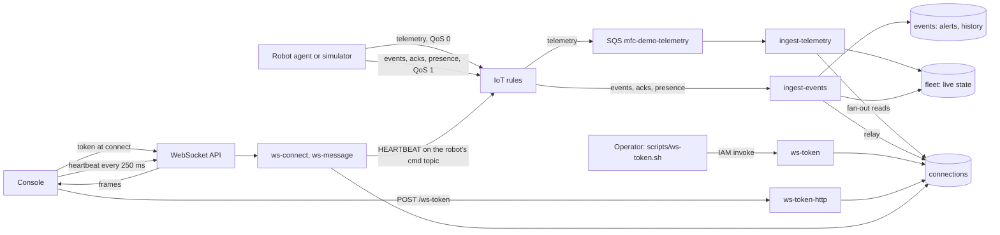

The MQTT topics are `fleet/<siteId>/<robotId>/telemetry`, `.../events`, `.../cmd` and `.../cmd/ack`. The IoT rules
forward telemetry to the queue and events, acknowledgements and presence to `ingest-events`. A delivery that a rule
cannot pass on goes to an SQS error queue, and an event whose invocation keeps failing goes to a dead-letter queue. The rules are in [ADR 0031](docs/adr/0031-iot-rule-deliveries-broker-metadata-and-base64-payload.md).

**Shared protocol.** The console and the robot agent share one package, [`packages/protocol`](packages/protocol/). It
holds the zod schemas, the JSON Schemas generated from them, the topic helpers and a fixture corpus that both
languages must read the same way. The robot's safety rules are one transition table in the same package. The Python
agent mirrors the schemas and the table, and a parity test fails when they diverge.
[`docs/STATE_MACHINE.md`](docs/STATE_MACHINE.md) is generated from the table. The rules are in
[ADR 0027](docs/adr/0027-robot-protocol-v1-envelopes-commands-acks-replay.md) (protocol) and
[ADR 0028](docs/adr/0028-robot-safety-state-machine-lock-deadman-estop-latch.md) (safety).

**Robot agent.** The agent (`agent/`, Python 3.12) runs one robot. It holds the MQTT 5 connection, publishes telemetry
and acknowledgements, applies the safety rules locally, and serves a local video page on `127.0.0.1` for the robot's
own operator. The kit of each robot stays on the machine that runs it. The operator procedures are in
[`docs/security/RUNBOOK_ROBOTS.md`](docs/security/RUNBOOK_ROBOTS.md).

## How it is secured

- **Identity.** Amazon Cognito, with no self sign-up. Accounts are created by an administrator. TOTP MFA is required for
  every role ([ADR 0044](docs/adr/0044-cognito-pool-admin-only-and-totp-for-every-role.md)). The console keeps its tokens
  in memory only ([ADR 0045](docs/adr/0045-console-auth-client-srp-memory-tokens.md)).
- **Authorisation.** The HTTP API checks the JWT. Each function checks the role and the site of the caller before any
  store call. The WebSocket token is single use, lasts 60 s, and is stored only as a digest.
- **Commands.** The cloud checks the role, the site, the lock and the demo mode on every command. Command identifiers
  are idempotent, and a replay with other values is refused. The robot checks the same rules again and refuses a
  command older than its freshness window, except an e-stop.
- **Robots.** One X.509 certificate per robot, and one IoT policy bound to the robot's thing name and attributes
  ([ADR 0030](docs/adr/0030-iot-policy-bound-to-thing-name-and-thing-attributes.md)). The private key is returned once
  by the registration and is never stored in AWS ([ADR 0029](docs/adr/0029-robot-provisioning-iam-invoked-function-state-idempotency.md)).
- **Browser.** The console is served from a private S3 bucket through CloudFront. The response headers include a strict
  Content Security Policy. A build check fails when the built `index.html` has an inline script, style or handler.
- **Audit.** CloudTrail records the management events of every Region
  ([ADR 0022](docs/adr/0022-multi-region-management-trail.md)). The application audit trail is described above.
- **Delivery.** GitHub Actions uses OIDC. No long-lived AWS key is stored anywhere. The deploy role cannot change the
  bootstrap or the CI roles ([ADR 0020](docs/adr/0020-github-oidc-roles-and-deploy-boundary.md)).
- **Verification.** The threats, the controls and the accepted risks are in
  [`docs/security/THREAT_MODEL.md`](docs/security/THREAT_MODEL.md). The checklist that each control is tested against is
  in [`docs/security/CHECKLIST.md`](docs/security/CHECKLIST.md). The CI and deploy controls are in
  [`docs/security/CI_CD.md`](docs/security/CI_CD.md). To report a vulnerability, see [`SECURITY.md`](SECURITY.md).

## Quick start

Prerequisites:

- Node.js 24, from `.nvmrc`. `engines.node` is `>=24.0.0`.
- pnpm 10.34.7 through Corepack: `corepack enable`. The version comes from the `packageManager` field.
- uv 0.13 and Python 3.12 for the robot agent. uv can install Python 3.12.
- pre-commit 4.7.0 for the git hooks.
- Optional, for the local gates: Gitleaks, Trivy, Terraform, TFLint, Checkov and ShellCheck.
  `.devcontainer/post-create.sh` installs them at the versions CI uses. A missing tool prints `SKIP`, and CI runs that
  check. `STRICT=1 make check` fails instead.

Commands:

```bash
make install   # pnpm install --frozen-lockfile, uv sync, git hooks
make check     # every quality gate, in CI order; no AWS call
make dev       # console on the Vite dev server, against the deployed API
```

`make help` lists every target.

`make dev` needs a runtime configuration. Copy `apps/console/public/config.json.example` to
`apps/console/public/config.json`, which is git-ignored, and replace each value with the matching Terraform output of
`infra/envs/demo` (`api_endpoint`, `ws_url`, `region`, `user_pool_id`, `user_pool_client_id`, `identity_pool_id`). Reading
the outputs needs an SSO session. Without a valid file, the console shows its start-up failure page.

## Run the demo

The demo runs the simulated fleet against the deployed stack, from the operator's machine. The commands:

```bash
git pull                 # on every machine first: nothing updates automatically
aws sso login            # the operator's own SSO session; no long-lived key
make demo                # checks the session, enables the consumer, starts N simulators (default 9)
make links               # prints the console, the Cognito user list and the IoT thing hub
make demo-ui             # local control page on 127.0.0.1:8765 (PORT=... to change it)
```

- `make demo` is safe to run twice: the second run starts nothing and prints the links. The simulators stop after 2 h.
  `make demo-stop` stops them and disables the ingest consumer; it stays the command-line stop.
- `make demo-ui` starts the page and prints its start URL on standard error. The token is in the URL fragment (`#token=`),
  so it is not sent to any server and not written to a log. Open that exact URL in a browser on the same machine.
- The page has four parts. **Simulated fleet**: Start, Stop, the console URL with Copy and Share, and the site name, which
  is read-only. **Real robot**: a card that says how to start it; the page has no Start or Stop for it. **Robots**: the
  registry of the site, with the kind (simulated or real), the registry status and the connection, when it is readable.
  **Operator accounts**: the Cognito users with their role and status, and a form that creates an Operator or Viewer
  account, or resets one.
- Stop cancels a Start that is still running, then stops the simulators and disables the consumer. Start is idempotent.
- The page lists robots and users. It does not add or delete robots: registration stays in `scripts/robots-admin.sh`.
- The account form runs `scripts/bootstrap-admin.sh` with the operator's SSO session, for Operator and Viewer accounts
  only: Admin accounts are made with `make bootstrap-admin` in a terminal. The temporary password is shown once, in the
  page, and stored nowhere; the page clears it on Hide, after 10 minutes, or when it is closed. A reset needs a confirm
  step, and it is refused for an Admin, an account with no group, or a disabled account. Design:
  [ADR 0076](docs/adr/0076-operator-accounts-from-the-demo-page.md).
- A real robot is registered and run on its own machine, with that machine's SSO session: `make agent ROBOT=<robot-id>`.
  The robot's kit is read in place from `~/.fleet/robots/<robot-id>/` on that machine, and never copied to another one.
  Enrolment by one-time token is planned in [ADR 0072](docs/adr/0072-robot-enrolment-by-one-time-token.md), and it is
  not built.
- In a Codespace, forward the page port in VS Code with visibility **Private**. Never set it to Public: the page is for
  the operator's own browser, and its checks refuse a request that is not addressed to 127.0.0.1 or localhost.
- The operator steps, the IAM actions the SSO role needs and the troubleshooting are in
  [`docs/security/RUNBOOK_DEMO.md`](docs/security/RUNBOOK_DEMO.md). Design: [ADR 0071](docs/adr/0071-local-demo-control-server.md).

Robot registration, from the operator's IAM session:

```bash
scripts/robots-admin.sh register --robot-id probe-01 --site-id paris-01 --name "Probe 01" --type PROBE \
  --design-date 2026-11-02 --simulated true --actor <your-name>
scripts/robots-admin.sh retire --robot-id probe-01 --site-id paris-01 --actor <your-name>
```

A registration creates the IoT thing, the certificate, the policy attachment and the KVS channel, then activates the
certificate. A retirement revokes the certificates, ends the robot's session and deletes its channel. Robot ids are
never reused. The procedures are in [`docs/security/RUNBOOK_ROBOTS.md`](docs/security/RUNBOOK_ROBOTS.md).

Operator tokens for a site: `scripts/ws-token.sh --site-id paris-01 --sub <user-sub> --role Operator` prints a
WebSocket URL and a token, valid for 60 s and usable once.

## Deploy

Infrastructure is Terraform in `infra/`, with two roots and separate state ([ADR 0005](docs/adr/0005-terraform-s3-locking-and-bootstrap.md)):

- `infra/bootstrap/` holds the state bucket, the GitHub OIDC provider, the CI roles and the permission boundary. The owner
  applies it from an SSO session after review. CI never applies it.
- `infra/envs/demo/` holds the application stack: the budgets, the audit trail, the alarm topic, the IoT rules, the
  queues, the functions, the APIs, the tables, the identity pools and the console delivery.
  The `audit-trail` module is applied by the owner from an SSO session, not by CI ([ADR 0024](docs/adr/0024-trail-bucket-read-only-to-ci.md)).

The workflows:

1. **Every pull request** runs `ci.yml` (TypeScript, Python, Terraform) and `security.yml`. `terraform-plan.yml` posts the
   plan of the demo stack as a comment when a pull request changes `infra/`, `services/` or `packages/protocol/`. That job
   is skipped while the `AWS_PLAN_ROLE_ARN` repository variable is unset.
2. **A merge to `main`** runs `deploy.yml`. It calls the CI and the security workflows on the same commit, plans the
   demo stack, and runs a destroy guard. The guard refuses a plan that deletes or replaces a resource, unless the owner
   re-runs the workflow by hand with `allow_destroy=true`. Then it applies the plan and runs `make smoke`. The job runs
   only when the `DEPLOY_ENABLED` repository variable is `true`.
3. **After a deploy**, the e2e job runs the Playwright scenario with its own role, and the DAST job runs the ZAP baseline.
   Both read the console origin from the stack outputs.
4. **Pull requests that touch `infra/` or `.github/`** are merged by the owner, after reading the plan comment.

Every AWS access in CI uses an OIDC role: the plan role (read-only), the deploy role and the e2e role. Humans use
`aws sso login`.

The console is not published by CI. The owner publishes it from the SSO session:

```bash
make publish-console                          # builds, writes config.json from the stack outputs, uploads, invalidates
make bootstrap-admin EMAIL=<address>          # creates the first Admin; prints a temporary password once
make smoke CONSOLE_URL=https://<console-host> # trail, alarm topic, IoT robot identity, and the console's headers and routes
```

`make smoke` runs in the deploy job without `CONSOLE_URL`, so the console checks run only when it is set. The deploy job
calls `make rollback` after a failed publish or smoke test, and that target is not built yet: it exits with an error.
A failed deploy therefore stays live until it is fixed or reverted by a new merge.

## Tests and quality gates

`make check` runs the gates of CI, in the same order. Locally, a gate whose tool is missing prints `SKIP`. The gates:

- **TypeScript:** Prettier, ESLint with zero warnings, `tsc` in strict mode, unit tests with coverage, the video page
  check (the committed bundle equals a fresh build), the production build, the CSP check and the fixture check of the
  built console.
- **Generated files:** the OpenAPI document and the protocol artifacts are up to date.
- **Python agent:** ruff format and lint, `mypy --strict`, pytest with a coverage gate.
- **Terraform:** `fmt`, the IoT policy inventory, `init` without backend, `validate` and `terraform test` for each root.
  The tests use mocked providers and make no AWS call.
- **Shell and workflows:** ShellCheck of `scripts/`, and zizmor for the GitHub workflows.
- **Infrastructure linters:** TFLint and Checkov.
- **Security:** Gitleaks over the full history, Semgrep with the blocking rules, Trivy, `pnpm audit`, and pip-audit on
  the locked Python set.

Coverage gates: 80 % of lines, branches, functions and statements for `services/api` (its domain layer), for
`packages/protocol`, for the console's pure logic and for the video page. The Python package has a gate of 80 %, and its
`core` modules a gate of 90 %.

Denied-access tests cover the protected routes. The suites are `services/api/test/denied-access*.test.ts`, and each
handler test file has its own refusal cases.

**Deployed end-to-end test.** The Playwright scenario (`apps/console/e2e/demo-scenario.spec.ts`) runs against the
deployed console, with the real user pool, the real API and the real IoT path. No credential is stored: each run creates
an Operator and a simulated robot, runs the scenario and deletes both ([ADR 0069](docs/adr/0069-deployed-e2e-ephemeral-operator-robot-and-ci-role.md)).

- `make e2e-setup` creates the user, registers the robot and starts the simulator. It needs `CONSOLE_URL`, `AWS_REGION`,
  and a session that can create the user and the robot.
- `make e2e` runs Playwright against that state, then scans the report for the run's passwords.
- `make e2e-teardown` stops the simulator, retires the robot, deletes the user and the local state. It is safe to run twice.

Locally, use an SSO session of an admin role, install Chromium with `pnpm exec playwright install chromium`, and run
`CONSOLE_URL=<console url> make e2e-setup e2e e2e-teardown`.

**OWASP ZAP baseline.** The DAST job scans the deployed console, with the AJAX spider. The first runs on `main` only
report, because the job is set to `fail_action: false`. After triage the job fails on findings
([ADR 0070](docs/adr/0070-zap-baseline-triage-policy.md)). The rules and their reasons are in `.zap/rules.tsv`.

## Costs

The target is 0 € out of pocket, on the AWS free tier and the account credits. This is a target, not a result: the
figures in [`docs/COSTS.md`](docs/COSTS.md) are estimates, and the daily Cost Explorer line is filled in as the days
pass.

- Three AWS Budgets send e-mail alerts on gross usage and on a net charge. Their thresholds are in
  `infra/envs/demo/budgets.tf`. They are imported, so `make destroy` leaves them alone ([ADR 0023](docs/adr/0023-alarm-channel-and-budgets-as-code.md)).
- The simulators stop by themselves after 2 h. `make demo-stop` stops them and disables the telemetry consumer, so no
  telemetry is processed while the demo is closed. `make demo-start` enables the consumer again.
- The telemetry queue keeps messages for one hour, and an idle queue costs only its requests.
- `make destroy` removes the demo stack. It is interactive and is run by the owner only, after a typed confirmation.

## Limits and what is not built

**Not built, by decision.** The ranked list is in [`docs/ROADMAP.md`](docs/ROADMAP.md).

- A users page. The console has no users route. Accounts are created with `make bootstrap-admin`
  or in the Cognito console. A future users page is bonus J in [`docs/ROADMAP.md`](docs/ROADMAP.md).
- A robots page to register and retire robots. Registration is the script above.
- Enrolment of a robot by one-time token ([ADR 0072](docs/adr/0072-robot-enrolment-by-one-time-token.md) is proposed).
  Today the kit is created in the cloud and carried to the robot's machine.
- A per-user command rate limit. Only the route throttles limit the commands.
- The cap of three simultaneous video viewers (SPEC FR-VID-2). It is not enforced.
- Multi-site and multi-tenant management. The demo is closed on one site, `paris-01`, in `eu-west-3`.
- E-mail notifications for alerts. The alarm topic carries CloudWatch alarms only.
- Keyboard driving (`DRIVE`), a data lake, and a still image kept with an incident.
- The robot's own answer in the audit trail. The trail records the cloud decision.

**Known limits of the delivered scope.**

- The real robot is an agent on a virtual machine with a webcam: it does not move. The webcam gives 1 to 3 frames per
  second, too few to measure the delay from a movement to its image.
- Load: with 20 simulated robots the Lambda concurrency limit of the account (10) was reached, so the demo is validated
  with at most ten. The command round trip was measured (p95 470 ms on 31 commands). The telemetry-to-screen latency
  was not. See [`docs/PERFORMANCE.md`](docs/PERFORMANCE.md).
- Lock: there is no force release of another operator's lock. Two tabs of one operator share the lock.
- The robot pauses when the operator's tab is hidden or the heartbeat is late. This is intended.
- Alerts: `collision` and "late mission" have no producer in the protocol, so they are not raised. A resolved alert is
  not checked against the robot's condition.
- Rollback is not built (see Deploy).
- No CloudWatch alarm covers every failure. The alarms on `main` cover Lambda errors and throttles, API 5xx, IoT rule
  errors, queue backlog and the heartbeat publish failures.
- Critical alert sound needs one click or key press after each page load.

**Roadmap.** The next items are in [`docs/ROADMAP.md`](docs/ROADMAP.md): a queue in front of `ingest-events` and a higher
Lambda quota to run 20 robots, the automatic resolution of alerts, the users and robots pages, then multi-site
management and a data lake.

## Repository layout

| Path                | Contents                                                                             |
| ------------------- | ------------------------------------------------------------------------------------ |
| `apps/console`      | React 19 and TypeScript single-page app: the console, its tests and the e2e scenario |
| `apps/robot-video`  | The robot's local video page, built into the agent                                   |
| `services/api`      | Lambda handlers in TypeScript (Node.js 24, ARM64, esbuild) and their domain layer    |
| `packages/protocol` | zod schemas, JSON Schemas, topic helpers, the robot state table and the fixtures     |
| `agent/`            | Python 3.12 robot agent, simulator, local video page, demo control page, DXF tools   |
| `infra/`            | Terraform: `bootstrap/`, `envs/demo/` and the `modules/`                             |
| `scripts/`          | Operator, demo, e2e and check scripts, called by the Makefile                        |
| `docs/`             | Specification, decisions, security, journal, performance, costs, screenshots, report |
| `.github/workflows` | CI, security, Terraform plan, deploy                                                 |

## Documentation map

- [`docs/SPEC.md`](docs/SPEC.md): the specification. It is the source of truth for behaviour.
- [`docs/adr/`](docs/adr/): one decision per file. The index is [`docs/adr/README.md`](docs/adr/README.md).
- [`docs/security/`](docs/security/): the threat model, the checklist, the CI and deploy controls and the runbooks.
- [`docs/JOURNAL.md`](docs/JOURNAL.md): the problems met, their causes and their fixes.
- [`docs/COSTS.md`](docs/COSTS.md): cost estimates and the daily log.
- [`docs/PERFORMANCE.md`](docs/PERFORMANCE.md): the measured latencies, the load check and what was not measured.
- [`docs/ROADMAP.md`](docs/ROADMAP.md): what is not built, ranked.
- [`docs/STATE_MACHINE.md`](docs/STATE_MACHINE.md): the robot state table, generated from the protocol package.
- [`docs/design/DESIGN.md`](docs/design/DESIGN.md): the locked visual design.
- [`docs/report/overleaf/`](docs/report/overleaf/): the two-page report in French (`main_fr.tex`), with its figures. The numbers it
  prints are traced in `docs/report/facts.md` and `docs/report/cost-estimate.md`.
- [`SECURITY.md`](SECURITY.md): how to report a vulnerability.

## License

MIT, see [`LICENSE`](LICENSE). The vendored Amazon Kinesis Video Streams WebRTC SDK keeps its own licence, next to it in
`vendor/`.
