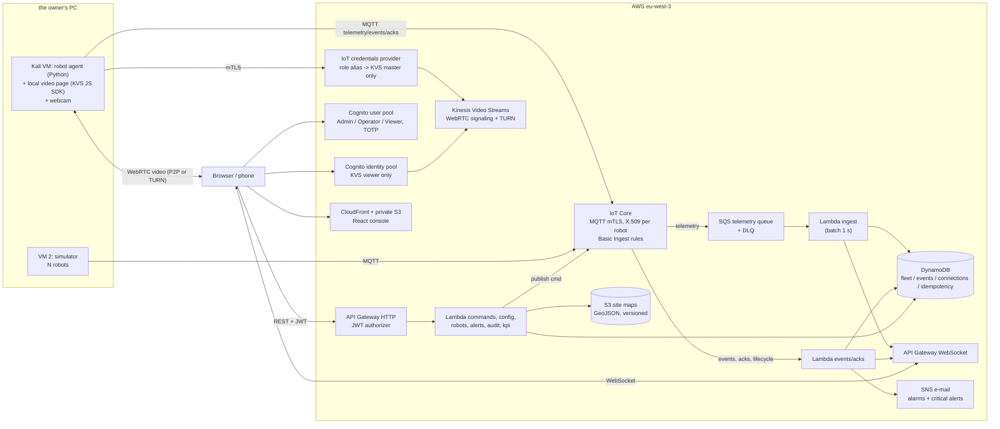

# Fleet Console — Specification

Status: frozen for the 30 Oct – 6 Nov 2026 build. Changes go through an ADR.
Requirement ids (`FR-`, `NFR-`, `SEC-`) are referenced in PRs, tests and the threat model.

## 1. Context and goal

Warehouse robots that work autonomously still need people: to watch the fleet, to take over a robot that is
stuck, and to measure what the fleet does. This project is a production-grade console for that work, built end
to end in one week: real-time fleet view, live camera, safe remote control, alerts, KPIs, infrastructure as code,
CI/CD and security.

### Audience and delivery

- Three roles use the console: a Viewer (for example the manager of the client site) follows the fleet read-only,
  an Operator supervises and takes control of a robot, an Admin creates accounts and configures sites. Every role
  needs TOTP MFA (ADR 0044).
- The console is reachable from a phone or a personal computer. The demo runs on AWS while it is needed, and the
  infrastructure is destroyed afterwards; the repository, the screenshots and the measurements remain.

### Demo scenario (2 minutes) — the acceptance test of the whole project

1. Sign in (Operator, MFA).
2. Fleet view: warehouse map rendered from GeoJSON, 10 robots moving, KPIs, health indicator.
3. A "robot blocked" alert fires (triggered from demo mode). Sound + visual notification.
4. Open the robot page: live camera with overlay (name, state, position, speed, latency).
5. Take control (lock), pause, send it back to base. ACKs and latencies visible.
6. Acknowledge then resolve the alert.
7. Open the audit log: every action with who, when, result.
8. Same console opened on a phone over 4G proves everything runs remotely.

## 2. Runtime environments

| Where                              | What runs                                                                                      | Notes                                                                                                         |
| ---------------------------------- | ---------------------------------------------------------------------------------------------- | ------------------------------------------------------------------------------------------------------------- |
| GitHub Codespaces (VS Code)        | Claude Code, development, unit tests, `terraform plan`                                         | 2-core machine, stop it when idle (free quota is limited)                                                     |
| AWS eu-west-3 (Paris)              | All cloud components                                                                           | Fallback eu-west-1 if KVS WebRTC is not available in eu-west-3 (check on day 1, ADR)                          |
| Kali Linux VM #1 on the owner's PC | Real robot agent (Python) + local video page (browser, KVS JS SDK) + webcam                    | Webcam passed through to the VM (VirtualBox Extension Pack `webcam attach`, or VMware USB). Validate on day 1 |
| VM #2 on the owner's PC            | Robot simulator (N simulated robots, one MQTT connection per robot, one certificate per robot) | Never on AWS: no permanent compute cost                                                                       |
| GitHub Actions                     | CI checks, plan, deploy, e2e, ZAP                                                              | OIDC to AWS, no stored keys                                                                                   |

AWS account: The owner's existing account (almost empty, with free credits). Root has MFA and no access keys.
Humans use IAM Identity Center (requires AWS Organizations, free) with `aws sso login --use-device-code`
from Codespaces. Check on day 0 that the account plan allows IoT Core and Kinesis Video Streams.

## 3. Architecture

Why this shape (each point becomes an ADR): serverless pay-per-use so the idle cost is close to zero;
no VPC, so no NAT Gateway; IoT Core for device identity (mTLS per robot) instead of homemade auth;
SQS batching between IoT and Lambda to cut invocations and WebSocket fan-out cost; KVS WebRTC for
sub-second video without running a media server; Cognito for MFA and groups without writing auth code.

## 4. Components

### 4.1 Robot agent (`agent/`, Python 3.12)

- AWS IoT Device SDK v2 (MQTT 5 if supported, otherwise MQTT 3.1.1), asyncio, pydantic v2 models
  generated or mirrored from `packages/protocol` JSON Schemas (a CI test checks both stay in sync).
- Configuration: an optional `agent.toml` in the robot's kit directory, and `FLEET_*` environment variables, read with
  pydantic and `tomllib` (ADR 0035). Precedence: defaults, file, environment, command line. The kit is the file
  `register-response.json` that `scripts/robots-admin.sh` writes, read in place and kept in memory. The agent refuses to
  start unless the kit file is mode 0600 or 0400, its directory is owner-only (0700 or narrower), and neither is a
  symlink or owned by another user (ADR 0035). There is no `simulated` setting: the kit sets it.
- Responsibilities: publish telemetry (2 Hz for the real robot), heartbeat every 5 s when idle, events,
  command ACK/REJECT; run the robot state machine; enforce deadman, control lock and replay protection;
  auto-reconnect with exponential backoff and jitter; graceful shutdown (publishes a `GOING_OFFLINE` event with
  reason `SHUTDOWN`; the robot never publishes `OFFLINE`, which the cloud sets, ADR 0027).
- Position of the real robot is simulated like the others; only its video is real (FR-ROB-6).
- Video: the agent serves a local page on `127.0.0.1` only (random port, random one-time token in the
  URL) that runs the KVS WebRTC **master** with the webcam. The agent obtains temporary AWS credentials
  from the IoT credentials provider (mTLS, role alias) scoped to `ConnectAsMaster` on its own channel
  and hands them to the page. Credentials never touch the disk.
- Visual confirmation of e-stop and teleop on the robot side: the local page shows a full-width banner.

### 4.2 Simulator (`agent/src/fleet_agent/sim/`)

- Same code path as the real agent (same state machine, same protocol), one process with one asyncio
  task and one MQTT connection per simulated robot, each with its own certificate.
- `make sim N=9` (configurable 1–20). Auto-stop after 2 h by default, at most 4 h; no option removes the auto-stop (cost guard).
- Loads the active site map (GeoJSON exported from the console). Path planning: occupancy grid at
  0.25 m from walls, obstacles and no-go zones inflated by the robot radius, A* between workstations,
  constant speed with acceleration limits.
- Missions generated in a loop: "pallet from station A to station C". Battery drains while moving and
  recharges at the charging base; robots go charging under 20 %.
- Faults: random (low rate, configurable) and on demand from the console demo mode: obstacle (BLOCKED),
  low battery, sensor fault, link loss (drops its MQTT connection for N seconds).
- Telemetry 0.5 Hz while moving (the console interpolates), immediately on state change,
  heartbeat 5 s when idle. Rationale and cost maths in `docs/COSTS.md`.

### 4.3 Cloud back end (`services/api`, TypeScript, Node.js LTS on Lambda, ARM64, esbuild)

Use the latest Node.js LTS runtime supported by Lambda on day 1 (22 or newer), AWS SDK v3,
Powertools for AWS Lambda (logger, metrics, tracer, idempotency, parser with zod). One handler per
function, thin handlers calling a pure `domain/` layer that is unit tested without AWS.

| Function                                      | Trigger                                                                                                                                                                                  | Does                                                                                                                                                                                                                                                                                                                                                                             |
| --------------------------------------------- | ---------------------------------------------------------------------------------------------------------------------------------------------------------------------------------------- | -------------------------------------------------------------------------------------------------------------------------------------------------------------------------------------------------------------------------------------------------------------------------------------------------------------------------------------------------------------------------------- |
| `ingest-telemetry`                            | SQS (batch ≤ 100, window 1 s)                                                                                                                                                            | Validates, drops out-of-order (`seq`), updates current state on change or every 10 s, broadcasts one aggregated WS message per connection per batch, raises alerts from telemetry                                                                                                                                                                                                |
| `ingest-events`                               | IoT rule (events, acks, lifecycle presence)                                                                                                                                              | Alerts open/resolve, OFFLINE on disconnect, ACK relay to the console, SNS for Critical/Major (bonus)                                                                                                                                                                                                                                                                             |
| `ws-connect` / `ws-disconnect` / `ws-message` | API GW WebSocket                                                                                                                                                                         | Token check on connect (short-lived token in query string, see SEC-API-5), connection record with TTL, heartbeats for the deadman (each valid heartbeat of the lock holder publishes one `HEARTBEAT` command on the robot's `cmd` topic, ADR 0063), subscribe to a site                                                                                                          |
| `ws-token`                                    | HTTP `POST /ws-token`                                                                                                                                                                    | Issues a 60 s single-use token bound to the user and site                                                                                                                                                                                                                                                                                                                        |
| `control`                                     | HTTP `/sites/{siteId}/robots`, `/sites/{siteId}/robots/{robotId}/lock` (GET, POST), `.../lock/release` (POST), `.../robots/{robotId}/commands` (POST), `/sites/{siteId}/demo` (GET, PUT) | Role and site check, command policy table, lock acquire, release and 30 s idle expiry (refreshed by the holder's commands and heartbeats), lock token minted and kept in the cloud, command claim on `commandId` (1 h), audit write, IoT publish, robot list, demo mode flag. One function, ADR 0062. Per-user rate limit: bonus, not in the delivered scope (`docs/ROADMAP.md`) |
| `robots`                                      | HTTP CRUD `/robots` (bonus, not in the delivered scope; in M9 the function is invoked by IAM from `scripts/robots-admin.sh`)                                                             | Register (creates thing, certificate, policy attachment, KVS channel; returns the one-time kit), update, retire (revoke cert, delete channel, keep history)                                                                                                                                                                                                                      |
| `site`                                        | HTTP `/sites/{id}` and `/sites/{id}/maps`                                                                                                                                                | Site config, presigned POST for GeoJSON upload, validation and activation of a map version, presigned GET                                                                                                                                                                                                                                                                        |
| `alerts`                                      | HTTP `/sites/{siteId}/alerts`                                                                                                                                                            | List, acknowledge, resolve                                                                                                                                                                                                                                                                                                                                                       |
| `audit`                                       | HTTP `/sites/{siteId}/audit`                                                                                                                                                             | Paginated audit log, newest first; filters by robot and result are bonus, not in the delivered scope                                                                                                                                                                                                                                                                             |
| `kpi`                                         | HTTP `/kpi`                                                                                                                                                                              | KPIs computed from DynamoDB (data lake version is a bonus)                                                                                                                                                                                                                                                                                                                       |
| `users`                                       | HTTP `/users` (Admin; bonus, not in the delivered scope)                                                                                                                                 | Create users in Cognito groups (no self sign-up), disable users                                                                                                                                                                                                                                                                                                                  |

Errors are RFC 7807. OpenAPI 3.1 is generated from the zod schemas (`pnpm openapi`) and committed.

### 4.4 Console (`apps/console`)

React 19, TypeScript strict, Vite, React Router, TanStack Query (server state), Zustand (real-time
state), Tailwind CSS + shadcn/ui, Lucide icons, react-i18next (`en`, `fr`, switch in the header,
remembered locally), Amplify Auth **or** a thin Cognito client for Hosted UI / SRP (ADR).
Each library choice is justified in an ADR (the owner asked for it).

Pages:

- **Sign in** (Cognito, MFA setup on first login for Admin/Operator).
- **Fleet**: SVG warehouse map (zoom, pan), robots as oriented icons with state badge, list with
  filters, KPI strip, health indicator (WS state, API latency, robots online), alert drawer.
- **Robot**: live video with overlay, telemetry, state timeline (bonus, not in the delivered scope), command panel (pause, resume, return to
  base, e-stop, take/release control), ACK status and latency for each command, who holds the lock.
- **Alerts**: list by severity and status, acknowledge, resolve, history.
- **Audit**: who did what, when, result, correlation id.
- **KPIs**: availability, missions per hour, error rate, interventions per robot, MTTR.
- **Site configuration (Admin)**: DXF import → layer mapping → GeoJSON preview → place charging base,
  workstations, no-go rectangles → save as new map version → activate. Download GeoJSON (for the
  simulator).
- **Robots (Admin)**: register (name, type, design date), one-time kit download, retire.
- **Users (Admin)**: create user with role, disable.
- **Demo mode (Admin)**: toggle with a permanent "DEMO MODE" banner; inject faults on simulated robots
  only; every injection is audited.

Responsive: desktop first; Fleet and Robot pages usable on a phone.
Design: **locked** (ADR 0004, "Console visual design"). Layout "Plan" (full-screen tilted map, glass side
panel, pages as sheets), validated robot state language, style "Graphite" (dark only). Source of truth:
`docs/design/DESIGN.md`. All colours, fonts, radii, spacing, sizes and durations live in
`apps/console/src/theme/tokens.ts` + `tokens.css`; state visuals in `robot-state-visuals.ts`.

### 4.5 Site map pipeline (DXF → GeoJSON → SVG)

- DXF is parsed **in the browser** (Web Worker, `dxf-parser` or equivalent, licence checked). The DXF
  never leaves the browser and is discarded after conversion; only GeoJSON is stored.
- Supported entities (minimal on purpose): LINE, LWPOLYLINE, POLYLINE, CIRCLE, ARC (approximated),
  INSERT exploded one level. Others are ignored and counted in a conversion report.
- Units from `$INSUNITS`, converted to metres; if missing, the admin enters the scale.
- Layer mapping step: each DXF layer is mapped to `wall`, `obstacle` (machines, racks, storage),
  `ignore`. Then the admin adds `charger`, `workstation` (points) and `nogo` (rectangles) in the editor.
- GeoJSON: FeatureCollection in a local metric frame (x, y in metres, origin bottom-left). RFC 7946
  mandates WGS84, so the file carries `"crs": "local-metric"` in a top-level `fleet` member and the
  deviation is recorded in an ADR.
- Server-side validation before activation (zod): ≤ 2 MB, ≤ 5 000 features, ≤ 50 000 vertices, finite
  numbers, bounding box ≤ 1 000 m, allowed feature kinds only, exactly one charger, ≥ 2 workstations.
- A workstation may carry an optional `size` (width and height in metres, 0.1 to 50) centred on its point; the
  point stays the mission target and the footprint counts for the extent limit (ADR 0056).
- Rendering: GeoJSON → SVG paths in React, memoised, robots on a separate layer.
- Sample: a free-licence warehouse DXF from the internet (licence and source recorded in
  `docs/JOURNAL.md`), with a fallback DXF generated by `agent/tools/make_sample_dxf.py` (ezdxf).
  Superseded by ADR 0055: the sample is the generated original drawing, not a downloaded file.

## 5. Protocol (`packages/protocol`)

MQTT topics (`site` and `robot` are lowercase ids `[a-z0-9-]{3,32}`):

| Topic                                                 | Direction     | QoS | Notes                                 |
| ----------------------------------------------------- | ------------- | --- | ------------------------------------- |
| `$aws/rules/telemetry/fleet/{site}/{robot}/telemetry` | robot → cloud | 0   | Basic Ingest (no broker fan-out cost) |
| `$aws/rules/events/fleet/{site}/{robot}/events`       | robot → cloud | 1   | State changes, faults, heartbeats     |
| `fleet/{site}/{robot}/cmd`                            | cloud → robot | 1   | Commands                              |
| `$aws/rules/acks/fleet/{site}/{robot}/cmd/ack`        | robot → cloud | 1   | ACK / REJECT                          |

Every message: `schemaVersion` (semver major checked), `messageId` (UUIDv7), `robotId`, `siteId`,
`ts` (ISO 8601 UTC, ms), `seq` (monotonic per robot boot), `bootId`.

- **Telemetry**: `x`, `y`, `heading` (rad), `state`, `battery` (0–100), `missionId?`, `speed` (m/s),
  `errorCode?`.
- **Command**: `commandId` (UUIDv7), `type` ∈ {`PAUSE`, `RESUME`, `RETURN_TO_BASE`, `ESTOP`,
  `ESTOP_RELEASE`, `TAKE_CONTROL`, `RELEASE_CONTROL`, `HEARTBEAT`, `DRIVE` (bonus), `SIMULATE_FAULT`
  (demo, simulated robots only)}, `issuedAt`, `issuedBy` (user sub), `lockToken?`, `params`.
- **Ack**: `commandId`, `result` ∈ {`ACK`, `REJECT`}, `reason?` ∈ {`EXPIRED`, `DUPLICATE`,
  `INVALID_STATE`, `NOT_LOCK_HOLDER`, `INVALID`, `NOT_SIMULATED`}, `robotTs`.
- **Token custody**: `lockToken` is minted and kept by the cloud in the lock item. The cloud sets it on the
  commands it publishes, only after it has checked that the caller holds the lock. The browser never receives it, and the
  WebSocket `heartbeat` frame carries no token (ADR 0062).

Robot-side rules: reject commands older than 2 s (clock skew tolerance documented; agent uses NTP),
reject `commandId` already seen (LRU of the last 1 000 ids per boot), reject anything failing the schema.

WebSocket messages (console ↔ cloud) are zod discriminated unions: `subscribe`, `heartbeat`,
`fleet.delta` (aggregated telemetry), `robot.event`, `command.ack`, `alert.changed`, `lock.changed`,
`error`.

## 6. Robot state machine

States: `IDLE`, `WORKING`, `MOVING`, `CHARGING`, `BLOCKED`, `PAUSED`, `TELEOP`, `ESTOP`, `OFFLINE`
(`OFFLINE` is set by the cloud, never by the robot). The full transition table lives in
`packages/protocol/src/state-machine.ts` and `agent/src/fleet_agent/core/state_machine.py`,
generated docs in `docs/STATE_MACHINE.md` (Mermaid `stateDiagram-v2`). Invariants, tested:

- `ESTOP` is reachable from every state and only left by `ESTOP_RELEASE` (explicit, Operator, audited; the console takes control first, so the release is lock-gated, ADR 0028),
  which goes to `IDLE` when the robot was `IDLE` at the e-stop and to `PAUSED` otherwise (also when the origin is unknown
  after a reboot), never directly to motion (ADR 0073).
- `TELEOP` only with a valid lock. The deadman is armed while the lock is held and the state is `TELEOP`, `MOVING`
  or `WORKING`. Without a valid command from the lock holder for 1 s, the robot stops and goes to `PAUSED`, keeping
  its resume target. The check runs every 50 ms (worst case about 1.05 s) and runs while the link is down. A motion
  with no lock holder is not armed (ADR 0028, accepted risk R29).
- `BLOCKED` is left only by `RESUME` after the cause is cleared, by `RETURN_TO_BASE`, or by `ESTOP` from any state (ADR 0028).
- Battery < 20 % → mission ends at next station → `MOVING` to charger → `CHARGING`.

## 7. Functional requirements

Accounts and roles

- FR-AUTH-1 Roles: Admin (site, robots, users, demo mode), Operator (supervise, command, alerts),
  Viewer (read only).
- FR-AUTH-2 No self sign-up. First Admin created by `make bootstrap-admin` after deploy.
- FR-AUTH-3 TOTP MFA mandatory for every role (Admin, Operator, Viewer), see ADR 0044.
- FR-AUTH-4 Access and ID tokens 15 min, refresh 8 h (shortened from 1 h, ADR 0044); teleop UI signs the user out of control after 30 min idle (bonus, not in the delivered scope).

Site

- FR-SITE-1 One site in the demo, `siteId` everywhere in the data model and API (multi-site ready).
- FR-SITE-2 Map pipeline as in §4.5, map versions kept, one active version.
- FR-SITE-3 Map shows walls and obstacles (human context), charging base, workstations, no-go zones.
  Simulated robots never enter obstacles or no-go zones.

Robots

- FR-ROB-1 Register: name, type, design date. Platform creates the IoT thing, certificate, policy
  attachment and KVS channel, returns a kit (cert, private key, config, CA) downloadable **once**.
  The private key is never stored in AWS after the response. The HTTP registration route is bonus, not in the delivered scope; in M9 the kit comes from `scripts/robots-admin.sh`.
- FR-ROB-2 Retire: revoke and detach certificate, delete KVS channel, keep history and audit. The HTTP retire route is bonus, not in the delivered scope.
- FR-ROB-3 Telemetry fields per §5; real robot 2 Hz; simulated 0.5 Hz while moving and on change;
  heartbeat 5 s; OFFLINE after 15 s without message (console side) or on MQTT disconnect (cloud side).
- FR-ROB-4 Missions between workstations generated by the simulator.
- FR-ROB-5 Faults random and on demand (demo mode): obstacle, low battery, sensor fault, link loss.
  A sensor fault puts the robot in `BLOCKED` with a sensor-fault flag (ADR 0004).
- FR-ROB-6 The webcam robot moves on the map like a simulated one; only its video is real.
- FR-ROB-7 Simulated fleet size configurable 1–20, started with one command.

Video

- FR-VID-1 720p, 15 fps, adaptive bitrate, target glass-to-glass latency < 500 ms (measured, shown).
- FR-VID-2 Up to 3 simultaneous viewers; only the lock holder can command. The 3-viewer cap is not enforced in M9 (bonus, see `docs/ROADMAP.md`).
- FR-VID-3 No recording. Bonus: still image captured on each incident.
- FR-VID-4 Overlay: robot name, state, position, speed, latency.

Commands and safety

- FR-CMD-1 Commands: pause, resume, return to base, e-stop, e-stop release, take/release control.
  Bonus: keyboard driving (`DRIVE`, only in `TELEOP`, rate-limited).
- FR-CMD-2 Control lock: one operator per robot; released explicitly or after 30 s idle; everyone
  sees who holds it.
- FR-CMD-3 Deadman: console heartbeat every 250 ms over the WebSocket while holding control;
  robot goes `PAUSED` after 1 s without heartbeat. The console sends `{ type: "heartbeat", robotId }` every 250 ms over the WebSocket while it holds the lock. The cloud turns each valid heartbeat from the lock holder into one `HEARTBEAT` command on the robot's `cmd` topic, and refuses every other heartbeat silently (ADR 0063).
- FR-CMD-4 E-stop always available to Operators (even without the lock), has priority over everything,
  only cleared by an explicit release; robot-side visual confirmation. One click sends the e-stop at once, with no confirmation; releasing asks for a confirmation in the panel (ADR 0066).
- FR-CMD-5 Every command has an id; robot answers ACK or REJECT with reason; console shows status and
  round-trip latency.

Alerts and KPIs

- FR-ALR-1 Severities: Critical (ESTOP, collision), Major (BLOCKED, OFFLINE), Minor (low battery, late
  mission), Info.
- FR-ALR-2 Lifecycle open → acknowledged (who, when) → resolved; visual + sound notification
  (sound can be muted).
- FR-ALR-3 (priority bonus) E-mail notification via SNS for Critical and Major, rate-limited
  (max 1 e-mail per robot per 5 min).
- FR-KPI-1 Availability, missions per hour, error rate, interventions per robot, MTTR, from DynamoDB.
- FR-KPI-2 (bonus) Firehose → S3 Parquet data lake + Athena queries.

Demo mode

- FR-DEMO-1 Admin-only toggle, visible banner, fault injection on robots flagged `simulated: true`
  only (robot also rejects with `NOT_SIMULATED`), audited.

Internationalisation

- FR-I18N-1 UI in English and French, switch in the header; code, API messages and logs in English.

## 8. Data model (DynamoDB, on-demand, PITR on, AWS-owned encryption)

Four tables, chosen over a single-table design for readability by a reviewer (ADR). Key schemas:

| Table         | PK                                                     | SK                                                                                      | GSIs                                                                                                                                                                                                                                 | TTL                                 |
| ------------- | ------------------------------------------------------ | --------------------------------------------------------------------------------------- | ------------------------------------------------------------------------------------------------------------------------------------------------------------------------------------------------------------------------------------ | ----------------------------------- |
| `fleet`       | `SITE#{siteId}`                                        | `META`, `ROBOT#{robotId}`, `MAP#{version}`, `LOCK#{robotId}`, `CMD#{commandId}`, `DEMO` | —                                                                                                                                                                                                                                    | lock `expiresAt`, command claim 1 h |
| `events`      | `SITE#{siteId}`                                        | `{ts}#{kind}#{id}` (kind = `ALERT`, `AUDIT`, `MISSION`)                                 | `byRobot` (`ROBOT#{robotId}`, `{ts}`), `openAlerts` (sparse: `SITE#{siteId}#OPEN` with `{severity}#{ts}`, `SITE#{siteId}#RESOLVED` with `{resolvedAt}#{alertId}` (ADR 0061), `SITE#{siteId}#AUDIT` with `{ts}#{auditId}` (ADR 0064)) | alerts 90 d, audit 365 d            |
| `connections` | `CONN#{connectionId}`                                  | —                                                                                       | `bySite` (`SITE#{siteId}`)                                                                                                                                                                                                           | 2 h                                 |
| `idempotency` | Not created: command claims live in `fleet` (ADR 0062) | —                                                                                       | —                                                                                                                                                                                                                                    | 1 h                                 |

Current robot state is written on state change or every 10 s, with a condition on `seq` to ignore
out-of-order messages. Positions in between go straight to the WebSocket, never to DynamoDB.

S3: `site-maps` bucket (private, Block Public Access, SSE-S3, versioning, TLS-only bucket policy,
presigned POST with `content-length-range` and content type, 5 min expiry, CORS for the console origin only, GET and POST, and a CSP `connect-src` naming that bucket host only), `console` bucket (private,
CloudFront OAC only), `logs` bucket for CloudFront/S3 access logs (30 d lifecycle), Terraform state
bucket (bootstrap).

## 9. Non-functional requirements

- NFR-PERF-1 Telemetry to screen p95 < 1 s; command round trip p95 < 500 ms; video latency < 500 ms.
- NFR-PERF-2 Console first load < 2 s on 4G (code splitting, compressed assets, long cache on hashed
  files).
- NFR-REL-1 Agent and console reconnect automatically with backoff and jitter; console shows a
  degraded state, never a blank page.
- NFR-REL-2 DLQs on SQS and async Lambdas; retries with backoff; idempotent handlers.
- NFR-REL-3 Failure scenarios documented and filmed: robot network cut, console closed during
  control (deadman), Lambda error, revoked certificate.
- NFR-OBS-1 Structured JSON logs with `correlationId` from console to robot (header
  `x-correlation-id`, propagated in command and ack), 7-day retention.
- NFR-OBS-2 Alarms by e-mail (SNS): Lambda errors, API 5xx and throttling, IoT rule failures, DLQ not
  empty, budget.
- NFR-OBS-3 X-Ray tracing on the HTTP API and Lambdas.
- NFR-COST-1 0 € out of pocket over the period: everything within free tier and credits.
  Budget alerts at 3 € and 5 € of gross usage, plus an alert on any net charge. See `docs/COSTS.md`.
- NFR-COST-2 Idle cost ≈ 0: serverless only, no VPC/NAT/ALB/EC2, simulators off AWS and auto-stopped.
- NFR-A11Y-1 WCAG 2.2 AA contrast, keyboard navigation, focus visible, no colour-only state.
- NFR-MAINT-1 Strict typing, ≥ 80 % coverage on domain logic, ADRs, README current.

## 10. Security requirements (summary; details in `docs/security/`)

- SEC-ID-1 One X.509 certificate per robot, attached to its own thing (`EXCLUSIVE_THING`), revocable. One IoT
  policy, `mfc-demo-robot`, for every robot: `iot:Connect` only on the client id `${iot:Connection.Thing.ThingName}`
  with `iot:Connection.Thing.IsAttached` required; the topics are bound to the thing attributes
  `${iot:Connection.Thing.Attributes[siteId]}` and `${iot:Connection.Thing.Attributes[robotId]}`, which only the
  robots function writes (no robot holds `iot:UpdateThing`). The thing name is `mfc-demo-<robotId>` (ADR 0020).
  Decision and alternatives: ADR 0030.
- SEC-ID-2 Robot KVS access via IoT credentials provider, role alias limited to `ConnectAsMaster`,
  `GetSignalingChannelEndpoint`, `GetIceServerConfig` on `arn:...:channel/${credentials-iot:ThingName}/*`.
- SEC-ID-3 Console KVS access via Cognito identity pool, role per group (Admin/Operator/Viewer), viewer-only
  actions; unauthenticated identities disabled.
- SEC-API-1 JWT authorizer on every HTTP route except health; role and site re-checked in every Lambda.
- SEC-API-2 Strict zod validation, body size limits, pagination limits, no mass assignment.
- SEC-API-3 Throttling: stage and route limits; the per-user command rate limit is bonus, not in the delivered scope (`docs/ROADMAP.md`).
- SEC-API-4 CORS only for the CloudFront origin (and localhost in dev stage only).
- SEC-API-5 WebSocket: 60 s single-use token on connect, re-check role and lock on each heartbeat/command,
  forced disconnect at token expiry, message size limit.
- SEC-CMD-1 Replay protection: `commandId` + `issuedAt` window 2 s + robot-side dedupe + server-side
  idempotency.
- SEC-WEB-1 CloudFront Response Headers Policy: strict CSP (no `unsafe-inline` scripts, `connect-src`
  limited to the API, WS, Cognito and KVS endpoints), HSTS, X-Content-Type-Options, Referrer-Policy,
  Permissions-Policy (camera none in the console), frame-ancestors none.
- SEC-WEB-2 Tokens kept in memory (refresh token handling per ADR), no tokens in localStorage.
- SEC-IAM-1 One role per Lambda, no `*` action on `*` resource, resource-level conditions.
  GitHub OIDC: plan role (read-only, trusted only for `pull_request` events of this repo) and deploy role
  (trusted only for `refs/heads/main` of this repo). See ADR 0020.
- SEC-SEC-1 No secret in the repo or CI. SSM Parameter Store for non-secret config.
  Gitleaks in pre-commit and CI.
- SEC-LOG-1 CloudTrail management events (free trail), application audit log, IoT logs at ERROR.
- SEC-SUP-1 Lockfiles committed, Dependabot, GitHub Actions pinned by SHA, dependency audit in CI.
- SEC-DAST-1 OWASP ZAP baseline on the deployed URL; automated denied-access tests (Viewer sending a
  command, Operator calling Admin routes, robot publishing on another robot's topic, expired token,
  replayed command).
- SEC-DET-1 GuardDuty and Security Hub (CIS AWS Foundations) on their 30-day free trial for the
  report screenshots, then disabled.

## 11. Out of scope (stated in the report as next steps)

Multi-site UI, WAF (cost; mitigated by throttling and CloudFront), custom KMS keys (cost; AWS-owned
keys), SMS notifications, video recording, real robot motion, ROS 2 bridge, HA multi-region,
penetration test by a third party.

## 12. Bonuses, in priority order

1. E-mail notifications for Critical/Major alerts (FR-ALR-3).
2. KPI page polish.
3. Still image on incident (FR-VID-3).
4. Keyboard driving (`DRIVE`).
5. Data lake (FR-KPI-2).
6. Custom domain (only with a domain the owner already owns; ACM + CloudFront alias).

Items marked "bonus, not in the delivered scope" in sections 4.3, 4.4 and 7 are listed in `docs/ROADMAP.md`.

## 13. Deliverables

- GitHub repository, green CI, README with screenshots and architecture.
- Live demo (CloudFront) while the infrastructure runs, with an Admin account and Operator accounts.
- A two-page project report in French (LaTeX, `docs/report/`).
- Measured performance in `docs/PERFORMANCE.md`.
