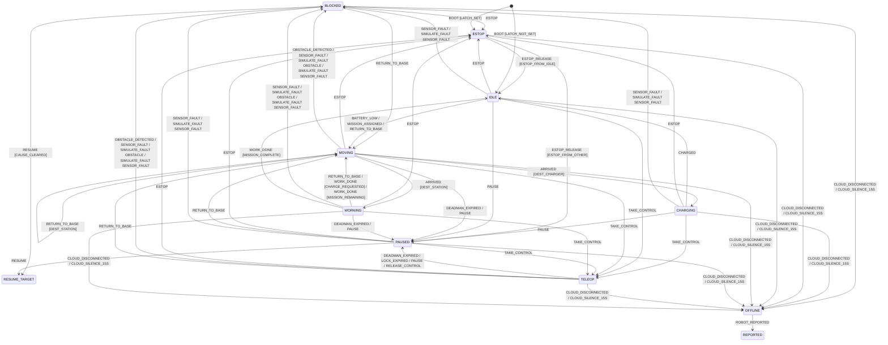

# Robot state machine

<!-- Generated from packages/protocol/src/state-machine.ts by `pnpm --filter @mfc/protocol generate`. Do not edit. -->

The robot rows below are the table the robot agent runs (`agent/src/fleet_agent/core/state_machine.py`);
a parity test compares the two row for row. `ESTOP` is reachable from every state and left only by
`ESTOP_RELEASE`.
The cloud marks a robot `OFFLINE`; the robot never reports that state itself.

## Diagram

Rows that keep the state (`SAME`) are omitted here; the tables below list every row.

## Robot rows

`reply` is `ACK` for an accepted command (a no-op is an `ACK` with `changed` false), `REJECT` with a
reason, or `NONE` for internal triggers and `HEARTBEAT`. `START` is the origin of the boot rows only.
`RESUME_TARGET` is a placeholder for the state the robot stored before pausing; `SAME` keeps the state.

| From     | Trigger                     | Guard             | To            | Effects                                                      | Reply  | Reason        |
| -------- | --------------------------- | ----------------- | ------------- | ------------------------------------------------------------ | ------ | ------------- |
| BLOCKED  | BATTERY_LOW                 | ALWAYS            | SAME          | REQUEST_CHARGE                                               | NONE   |               |
| BLOCKED  | CAUSE_CLEARED               | ALWAYS            | SAME          | CLEAR_CAUSE                                                  | NONE   |               |
| BLOCKED  | ESTOP                       | ALWAYS            | ESTOP         | STOP_MOTION, ABORT_MISSION, LATCH_ESTOP, RECORD_ESTOP_ORIGIN | ACK    |               |
| BLOCKED  | HEARTBEAT                   | ALWAYS            | SAME          | none                                                         | NONE   |               |
| BLOCKED  | LOCK_EXPIRED                | ALWAYS            | SAME          | RELEASE_LOCK                                                 | NONE   |               |
| BLOCKED  | RELEASE_CONTROL             | ALWAYS            | SAME          | RELEASE_LOCK                                                 | ACK    |               |
| BLOCKED  | RESUME                      | CAUSE_CLEARED     | RESUME_TARGET | CLEAR_CAUSE                                                  | ACK    |               |
| BLOCKED  | RESUME                      | CAUSE_PENDING     | SAME          | none                                                         | REJECT | INVALID_STATE |
| BLOCKED  | RETURN_TO_BASE              | ALWAYS            | MOVING        | ABORT_MISSION, SET_DEST_CHARGER, CLEAR_CAUSE                 | ACK    |               |
| BLOCKED  | SIMULATE_FAULT:BATTERY_LOW  | ALWAYS            | SAME          | SET_BATTERY_LOW                                              | ACK    |               |
| BLOCKED  | SIMULATE_FAULT:LINK_LOSS    | ALWAYS            | SAME          | DROP_LINK                                                    | ACK    |               |
| BLOCKED  | TAKE_CONTROL                | ALWAYS            | SAME          | ACQUIRE_LOCK                                                 | ACK    |               |
| CHARGING | CHARGED                     | ALWAYS            | IDLE          | none                                                         | NONE   |               |
| CHARGING | ESTOP                       | ALWAYS            | ESTOP         | STOP_MOTION, ABORT_MISSION, LATCH_ESTOP, RECORD_ESTOP_ORIGIN | ACK    |               |
| CHARGING | HEARTBEAT                   | ALWAYS            | SAME          | none                                                         | NONE   |               |
| CHARGING | LOCK_EXPIRED                | ALWAYS            | SAME          | RELEASE_LOCK                                                 | NONE   |               |
| CHARGING | PAUSE                       | ALWAYS            | PAUSED        | STOP_MOTION, RESUME_TARGET_FROM                              | ACK    |               |
| CHARGING | RELEASE_CONTROL             | ALWAYS            | SAME          | RELEASE_LOCK                                                 | ACK    |               |
| CHARGING | RETURN_TO_BASE              | ALWAYS            | SAME          | none                                                         | ACK    |               |
| CHARGING | SENSOR_FAULT                | ALWAYS            | BLOCKED       | STOP_MOTION, RESUME_TARGET_FROM, MARK_CAUSE                  | NONE   |               |
| CHARGING | SIMULATE_FAULT:BATTERY_LOW  | ALWAYS            | SAME          | SET_BATTERY_LOW                                              | ACK    |               |
| CHARGING | SIMULATE_FAULT:LINK_LOSS    | ALWAYS            | SAME          | DROP_LINK                                                    | ACK    |               |
| CHARGING | SIMULATE_FAULT:SENSOR_FAULT | ALWAYS            | BLOCKED       | STOP_MOTION, RESUME_TARGET_FROM, MARK_CAUSE                  | ACK    |               |
| CHARGING | TAKE_CONTROL                | ALWAYS            | TELEOP        | ACQUIRE_LOCK, STOP_MOTION, ABORT_MISSION                     | ACK    |               |
| ESTOP    | BATTERY_LOW                 | ALWAYS            | SAME          | REQUEST_CHARGE                                               | NONE   |               |
| ESTOP    | ESTOP                       | ALWAYS            | SAME          | none                                                         | ACK    |               |
| ESTOP    | ESTOP_RELEASE               | ESTOP_FROM_IDLE   | IDLE          | CLEAR_ESTOP_LATCH, RESUME_TARGET_IDLE                        | ACK    |               |
| ESTOP    | ESTOP_RELEASE               | ESTOP_FROM_OTHER  | PAUSED        | CLEAR_ESTOP_LATCH, RESUME_TARGET_IDLE                        | ACK    |               |
| ESTOP    | HEARTBEAT                   | ALWAYS            | SAME          | none                                                         | NONE   |               |
| ESTOP    | LOCK_EXPIRED                | ALWAYS            | SAME          | RELEASE_LOCK                                                 | NONE   |               |
| ESTOP    | RELEASE_CONTROL             | ALWAYS            | SAME          | RELEASE_LOCK                                                 | ACK    |               |
| ESTOP    | TAKE_CONTROL                | ALWAYS            | SAME          | ACQUIRE_LOCK                                                 | ACK    |               |
| IDLE     | BATTERY_LOW                 | ALWAYS            | MOVING        | SET_DEST_CHARGER                                             | NONE   |               |
| IDLE     | ESTOP                       | ALWAYS            | ESTOP         | STOP_MOTION, ABORT_MISSION, LATCH_ESTOP, RECORD_ESTOP_ORIGIN | ACK    |               |
| IDLE     | HEARTBEAT                   | ALWAYS            | SAME          | none                                                         | NONE   |               |
| IDLE     | LOCK_EXPIRED                | ALWAYS            | SAME          | RELEASE_LOCK                                                 | NONE   |               |
| IDLE     | MISSION_ASSIGNED            | ALWAYS            | MOVING        | SET_DEST_STATION                                             | NONE   |               |
| IDLE     | PAUSE                       | ALWAYS            | PAUSED        | STOP_MOTION, RESUME_TARGET_FROM                              | ACK    |               |
| IDLE     | RELEASE_CONTROL             | ALWAYS            | SAME          | RELEASE_LOCK                                                 | ACK    |               |
| IDLE     | RETURN_TO_BASE              | ALWAYS            | MOVING        | ABORT_MISSION, SET_DEST_CHARGER, CLEAR_CAUSE                 | ACK    |               |
| IDLE     | SENSOR_FAULT                | ALWAYS            | BLOCKED       | STOP_MOTION, RESUME_TARGET_FROM, MARK_CAUSE                  | NONE   |               |
| IDLE     | SIMULATE_FAULT:BATTERY_LOW  | ALWAYS            | SAME          | SET_BATTERY_LOW                                              | ACK    |               |
| IDLE     | SIMULATE_FAULT:LINK_LOSS    | ALWAYS            | SAME          | DROP_LINK                                                    | ACK    |               |
| IDLE     | SIMULATE_FAULT:SENSOR_FAULT | ALWAYS            | BLOCKED       | STOP_MOTION, RESUME_TARGET_FROM, MARK_CAUSE                  | ACK    |               |
| IDLE     | TAKE_CONTROL                | ALWAYS            | TELEOP        | ACQUIRE_LOCK, STOP_MOTION, ABORT_MISSION                     | ACK    |               |
| MOVING   | ARRIVED                     | DEST_CHARGER      | CHARGING      | none                                                         | NONE   |               |
| MOVING   | ARRIVED                     | DEST_STATION      | WORKING       | none                                                         | NONE   |               |
| MOVING   | BATTERY_LOW                 | ALWAYS            | SAME          | REQUEST_CHARGE                                               | NONE   |               |
| MOVING   | DEADMAN_EXPIRED             | ALWAYS            | PAUSED        | STOP_MOTION, RESUME_TARGET_FROM                              | NONE   |               |
| MOVING   | ESTOP                       | ALWAYS            | ESTOP         | STOP_MOTION, ABORT_MISSION, LATCH_ESTOP, RECORD_ESTOP_ORIGIN | ACK    |               |
| MOVING   | HEARTBEAT                   | ALWAYS            | SAME          | none                                                         | NONE   |               |
| MOVING   | LOCK_EXPIRED                | ALWAYS            | SAME          | RELEASE_LOCK                                                 | NONE   |               |
| MOVING   | OBSTACLE_DETECTED           | ALWAYS            | BLOCKED       | STOP_MOTION, RESUME_TARGET_FROM, MARK_CAUSE                  | NONE   |               |
| MOVING   | PAUSE                       | ALWAYS            | PAUSED        | STOP_MOTION, RESUME_TARGET_FROM                              | ACK    |               |
| MOVING   | RELEASE_CONTROL             | ALWAYS            | SAME          | RELEASE_LOCK                                                 | ACK    |               |
| MOVING   | RETURN_TO_BASE              | DEST_CHARGER      | SAME          | none                                                         | ACK    |               |
| MOVING   | RETURN_TO_BASE              | DEST_STATION      | MOVING        | ABORT_MISSION, SET_DEST_CHARGER                              | ACK    |               |
| MOVING   | SENSOR_FAULT                | ALWAYS            | BLOCKED       | STOP_MOTION, RESUME_TARGET_FROM, MARK_CAUSE                  | NONE   |               |
| MOVING   | SIMULATE_FAULT:BATTERY_LOW  | ALWAYS            | SAME          | SET_BATTERY_LOW                                              | ACK    |               |
| MOVING   | SIMULATE_FAULT:LINK_LOSS    | ALWAYS            | SAME          | DROP_LINK                                                    | ACK    |               |
| MOVING   | SIMULATE_FAULT:OBSTACLE     | ALWAYS            | BLOCKED       | STOP_MOTION, RESUME_TARGET_FROM, MARK_CAUSE                  | ACK    |               |
| MOVING   | SIMULATE_FAULT:SENSOR_FAULT | ALWAYS            | BLOCKED       | STOP_MOTION, RESUME_TARGET_FROM, MARK_CAUSE                  | ACK    |               |
| MOVING   | TAKE_CONTROL                | ALWAYS            | TELEOP        | ACQUIRE_LOCK, STOP_MOTION, ABORT_MISSION                     | ACK    |               |
| PAUSED   | BATTERY_LOW                 | ALWAYS            | SAME          | REQUEST_CHARGE                                               | NONE   |               |
| PAUSED   | ESTOP                       | ALWAYS            | ESTOP         | STOP_MOTION, ABORT_MISSION, LATCH_ESTOP, RECORD_ESTOP_ORIGIN | ACK    |               |
| PAUSED   | HEARTBEAT                   | ALWAYS            | SAME          | none                                                         | NONE   |               |
| PAUSED   | LOCK_EXPIRED                | ALWAYS            | SAME          | RELEASE_LOCK                                                 | NONE   |               |
| PAUSED   | PAUSE                       | ALWAYS            | SAME          | none                                                         | ACK    |               |
| PAUSED   | RELEASE_CONTROL             | ALWAYS            | SAME          | RELEASE_LOCK                                                 | ACK    |               |
| PAUSED   | RESUME                      | ALWAYS            | RESUME_TARGET | none                                                         | ACK    |               |
| PAUSED   | RETURN_TO_BASE              | ALWAYS            | MOVING        | ABORT_MISSION, SET_DEST_CHARGER, CLEAR_CAUSE                 | ACK    |               |
| PAUSED   | SENSOR_FAULT                | ALWAYS            | BLOCKED       | STOP_MOTION, RESUME_TARGET_FROM, MARK_CAUSE                  | NONE   |               |
| PAUSED   | SIMULATE_FAULT:BATTERY_LOW  | ALWAYS            | SAME          | SET_BATTERY_LOW                                              | ACK    |               |
| PAUSED   | SIMULATE_FAULT:LINK_LOSS    | ALWAYS            | SAME          | DROP_LINK                                                    | ACK    |               |
| PAUSED   | SIMULATE_FAULT:SENSOR_FAULT | ALWAYS            | BLOCKED       | STOP_MOTION, RESUME_TARGET_FROM, MARK_CAUSE                  | ACK    |               |
| PAUSED   | TAKE_CONTROL                | ALWAYS            | TELEOP        | ACQUIRE_LOCK, STOP_MOTION, ABORT_MISSION                     | ACK    |               |
| START    | BOOT                        | LATCH_NOT_SET     | IDLE          | none                                                         | NONE   |               |
| START    | BOOT                        | LATCH_SET         | ESTOP         | none                                                         | NONE   |               |
| TELEOP   | BATTERY_LOW                 | ALWAYS            | SAME          | REQUEST_CHARGE                                               | NONE   |               |
| TELEOP   | DEADMAN_EXPIRED             | ALWAYS            | PAUSED        | STOP_MOTION, RESUME_TARGET_FROM                              | NONE   |               |
| TELEOP   | ESTOP                       | ALWAYS            | ESTOP         | STOP_MOTION, ABORT_MISSION, LATCH_ESTOP, RECORD_ESTOP_ORIGIN | ACK    |               |
| TELEOP   | HEARTBEAT                   | ALWAYS            | SAME          | none                                                         | NONE   |               |
| TELEOP   | LOCK_EXPIRED                | ALWAYS            | PAUSED        | RELEASE_LOCK, STOP_MOTION, RESUME_TARGET_IDLE                | NONE   |               |
| TELEOP   | OBSTACLE_DETECTED           | ALWAYS            | BLOCKED       | STOP_MOTION, RESUME_TARGET_FROM, MARK_CAUSE                  | NONE   |               |
| TELEOP   | PAUSE                       | ALWAYS            | PAUSED        | STOP_MOTION, RESUME_TARGET_FROM                              | ACK    |               |
| TELEOP   | RELEASE_CONTROL             | ALWAYS            | PAUSED        | RELEASE_LOCK, STOP_MOTION, RESUME_TARGET_IDLE                | ACK    |               |
| TELEOP   | RETURN_TO_BASE              | ALWAYS            | MOVING        | ABORT_MISSION, SET_DEST_CHARGER, CLEAR_CAUSE                 | ACK    |               |
| TELEOP   | SENSOR_FAULT                | ALWAYS            | BLOCKED       | STOP_MOTION, RESUME_TARGET_FROM, MARK_CAUSE                  | NONE   |               |
| TELEOP   | SIMULATE_FAULT:BATTERY_LOW  | ALWAYS            | SAME          | SET_BATTERY_LOW                                              | ACK    |               |
| TELEOP   | SIMULATE_FAULT:LINK_LOSS    | ALWAYS            | SAME          | DROP_LINK                                                    | ACK    |               |
| TELEOP   | SIMULATE_FAULT:OBSTACLE     | ALWAYS            | BLOCKED       | STOP_MOTION, RESUME_TARGET_FROM, MARK_CAUSE                  | ACK    |               |
| TELEOP   | SIMULATE_FAULT:SENSOR_FAULT | ALWAYS            | BLOCKED       | STOP_MOTION, RESUME_TARGET_FROM, MARK_CAUSE                  | ACK    |               |
| TELEOP   | TAKE_CONTROL                | ALWAYS            | SAME          | ACQUIRE_LOCK                                                 | ACK    |               |
| WORKING  | BATTERY_LOW                 | ALWAYS            | SAME          | REQUEST_CHARGE                                               | NONE   |               |
| WORKING  | DEADMAN_EXPIRED             | ALWAYS            | PAUSED        | STOP_MOTION, RESUME_TARGET_FROM                              | NONE   |               |
| WORKING  | ESTOP                       | ALWAYS            | ESTOP         | STOP_MOTION, ABORT_MISSION, LATCH_ESTOP, RECORD_ESTOP_ORIGIN | ACK    |               |
| WORKING  | HEARTBEAT                   | ALWAYS            | SAME          | none                                                         | NONE   |               |
| WORKING  | LOCK_EXPIRED                | ALWAYS            | SAME          | RELEASE_LOCK                                                 | NONE   |               |
| WORKING  | PAUSE                       | ALWAYS            | PAUSED        | STOP_MOTION, RESUME_TARGET_FROM                              | ACK    |               |
| WORKING  | RELEASE_CONTROL             | ALWAYS            | SAME          | RELEASE_LOCK                                                 | ACK    |               |
| WORKING  | RETURN_TO_BASE              | ALWAYS            | MOVING        | ABORT_MISSION, SET_DEST_CHARGER, CLEAR_CAUSE                 | ACK    |               |
| WORKING  | SENSOR_FAULT                | ALWAYS            | BLOCKED       | STOP_MOTION, RESUME_TARGET_FROM, MARK_CAUSE                  | NONE   |               |
| WORKING  | SIMULATE_FAULT:BATTERY_LOW  | ALWAYS            | SAME          | SET_BATTERY_LOW                                              | ACK    |               |
| WORKING  | SIMULATE_FAULT:LINK_LOSS    | ALWAYS            | SAME          | DROP_LINK                                                    | ACK    |               |
| WORKING  | SIMULATE_FAULT:OBSTACLE     | ALWAYS            | BLOCKED       | STOP_MOTION, RESUME_TARGET_FROM, MARK_CAUSE                  | ACK    |               |
| WORKING  | SIMULATE_FAULT:SENSOR_FAULT | ALWAYS            | BLOCKED       | STOP_MOTION, RESUME_TARGET_FROM, MARK_CAUSE                  | ACK    |               |
| WORKING  | TAKE_CONTROL                | ALWAYS            | TELEOP        | ACQUIRE_LOCK, STOP_MOTION, ABORT_MISSION                     | ACK    |               |
| WORKING  | WORK_DONE                   | CHARGE_REQUESTED  | MOVING        | END_MISSION, SET_DEST_CHARGER                                | NONE   |               |
| WORKING  | WORK_DONE                   | MISSION_COMPLETE  | IDLE          | END_MISSION                                                  | NONE   |               |
| WORKING  | WORK_DONE                   | MISSION_REMAINING | MOVING        | SET_DEST_STATION                                             | NONE   |               |

## Cloud rows

`REPORTED` is a placeholder for the state the robot reports; the cloud resolves it from the message.

| From     | Trigger            | To       |
| -------- | ------------------ | -------- |
| BLOCKED  | CLOUD_DISCONNECTED | OFFLINE  |
| BLOCKED  | CLOUD_SILENCE_15S  | OFFLINE  |
| CHARGING | CLOUD_DISCONNECTED | OFFLINE  |
| CHARGING | CLOUD_SILENCE_15S  | OFFLINE  |
| ESTOP    | CLOUD_DISCONNECTED | OFFLINE  |
| ESTOP    | CLOUD_SILENCE_15S  | OFFLINE  |
| IDLE     | CLOUD_DISCONNECTED | OFFLINE  |
| IDLE     | CLOUD_SILENCE_15S  | OFFLINE  |
| MOVING   | CLOUD_DISCONNECTED | OFFLINE  |
| MOVING   | CLOUD_SILENCE_15S  | OFFLINE  |
| OFFLINE  | ROBOT_REPORTED     | REPORTED |
| PAUSED   | CLOUD_DISCONNECTED | OFFLINE  |
| PAUSED   | CLOUD_SILENCE_15S  | OFFLINE  |
| TELEOP   | CLOUD_DISCONNECTED | OFFLINE  |
| TELEOP   | CLOUD_SILENCE_15S  | OFFLINE  |
| WORKING  | CLOUD_DISCONNECTED | OFFLINE  |
| WORKING  | CLOUD_SILENCE_15S  | OFFLINE  |
