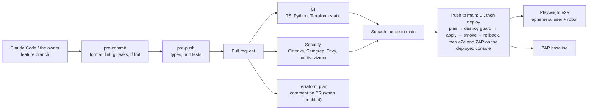

# CI/CD and repository protection

Repository: `vinsl/robot-fleet-console` (private). Decisions: ADR 0002 (CI security gate) and
ADR 0003 (GitHub Free plan).

## Pipeline overview



| Stage               | Tool                                                                                                                                                                                                                                       | Blocks on                            |
| ------------------- | ------------------------------------------------------------------------------------------------------------------------------------------------------------------------------------------------------------------------------------------ | ------------------------------------ |
| Commit              | pre-commit: whitespace, YAML/JSON/TOML, large files, private keys, AWS credentials already present on the machine (detect-aws-credentials), Gitleaks (pattern detection), Ruff, Prettier, ESLint, terraform fmt, tflint, no commit to main | any finding                          |
| Push                | tsc, mypy --strict, unit tests                                                                                                                                                                                                             | any failure                          |
| PR — CI             | ESLint, Prettier, tsc, Vitest + coverage ≥ 80 % on domain code, Ruff, mypy, pytest + coverage, generated schemas/OpenAPI in sync, front build, terraform fmt, validate and `terraform test` (mocked providers), tflint, Checkov            | any failure                          |
| PR — Security       | Gitleaks binary (full history), Semgrep CE (registry + project rules), Trivy (vuln, misconfig, secret; HIGH/CRITICAL), pnpm audit, pip-audit, zizmor (workflow hardening)                                                                  | any finding at the threshold         |
| PR — Plan           | `terraform plan` with read-only OIDC role (`terraform-plan.yml`), posted as a comment, deletions highlighted. Skipped until `AWS_PLAN_ROLE_ARN` is set                                                                                     | plan error                           |
| Main — Deploy       | Push to `main` calls `ci.yml` and `security.yml` on the same commit, then plan, destroy guard, apply, smoke tests, rollback (the console is published from the operator's SSO session, not from CI)                                        | CI, security, guard or smoke failure |
| Main — After deploy | Playwright e2e, ZAP baseline                                                                                                                                                                                                               | any failure (fix forward)            |
| Weekly              | Security workflow on schedule, Dependabot                                                                                                                                                                                                  | new CVE                              |

Secret scanning has two layers. detect-aws-credentials only flags AWS credentials already present in
`~/.aws/credentials` or the environment; it does no pattern matching on file content. Gitleaks is the
detector for secrets in content, in pre-commit and in CI.

The Gitleaks scanner runs as a pinned binary with its SHA-256 digest checked, not through
`gitleaks-action`. The reasons are in ADR 0002.

## GitHub plan: Free, with procedural protection

Facts from the GitHub docs, checked on 30 Oct 2026:

- Branch protection rules and rulesets on **private** repositories need GitHub Pro, Team or Enterprise.
  On Free the API returns 403.
- Environments on private repositories need Pro, Team or Enterprise; required reviewers on private
  repositories are not available on Free, Pro or Team.
- Code scanning (CodeQL) on private repositories needs GitHub Code Security (paid), even on Pro.
  This is why SAST runs with Semgrep CE as a blocking check instead of CodeQL alerts.

The owner chose the **Free plan** on 31 Oct 2026 (ADR 0003). The same rules are enforced without
server-side protection:

1. The `no-commit-to-branch` pre-commit hook and a local guard hook (kept outside the repository) block commits and
   pushes to `main` locally.
2. The local guard hook also refuses pushes to `main` and force pushes.
3. Merges only through `gh pr merge --squash` after `gh pr checks` is fully green (repository rule).
4. `deploy.yml` runs on `push` to `main` and calls `ci.yml` and `security.yml` on the same commit. The deploy job
   needs both, so a commit that fails the quality or security gate on `main` never deploys.

State this limit honestly in the report: protection is procedural, not enforced by GitHub.

`infra/github/ruleset-main.json` is kept for a future paid plan. Applying it needs a paid plan on this
private repository:

```bash
gh api -X POST repos/vinsl/robot-fleet-console/rulesets --input infra/github/ruleset-main.json
```

## AWS access from CI (OIDC, no stored keys)

Repository **variables** (not secrets, none of these is sensitive): `AWS_REGION`, `AWS_PLAN_ROLE_ARN`,
`AWS_DEPLOY_ROLE_ARN`, `DEPLOY_ENABLED` (`true` once PR B, the demo root, is merged).

Trust policies (created by `infra/bootstrap`):

- Plan role: `token.actions.githubusercontent.com:aud = sts.amazonaws.com` and
  `sub = repo:vinsl@84448605/robot-fleet-console@1439837333:pull_request`. Permissions: `ReadOnlyAccess` minus data
  reads (deny `s3:GetObject` except the state bucket, deny `dynamodb:GetItem/Query/Scan`), state bucket read.
- Deploy role: `sub = repo:vinsl@84448605/robot-fleet-console@1439837333:ref:refs/heads/main`. Permissions scoped to the
  services and name prefix `mfc-demo-*` used by the project (documented in an ADR; Checkov must pass).

## Deploy safety

- `deploy.yml` refuses any plan that deletes or replaces a resource. The owner reviews and re-runs it
  manually with `allow_destroy=true` when the deletion is intended.
- `make destroy` (the owner only) removes the three budgets from the state before it destroys the stack, so the
  teardown leaves them alone (ADR 0023). A plan that would delete a budget fails at plan time, because the
  budgets have `prevent_destroy`.
- Lambda functions are published as versions behind a `live` alias; rollback moves the alias back and
  restores the previous console build (`make rollback`).
- Smoke tests: `/health` 200, console `index.html` 200 with the security headers, WebSocket handshake
  rejected without a token. They run in the deploy job, before the ephemeral e2e user exists, so they make no
  authenticated call. The authenticated read (the robot list through the real API with a real token) is part of
  the e2e spec (ADR 0069).
- E2E job: assumes its own role `mfc-demo-gha-e2e` (`vars.AWS_E2E_ROLE_ARN`), trusted only for the `main` subject,
  never the deploy role (ADR 0069). ZAP baseline rollout and triage: ADR 0070.
